# Assembly in pictures (15 Nov 2026)

One picture per step, made from the CAD (`python cad/v2/render_steps.py`, about 1 minute). **Orange** = what you fit in that step, **grey** = already fitted. Left: whole machine. Right: close-up.

Each step says what you **fit**, how you **line it up**, and what you **check**. Tools are the ones already on the parts list: dial test indicator + magnetic base (X01), 200 mm level (X02), 500 mm straightedge (X05), feeler gauges (X06), torque wrench (X07).

This is an overview. The full procedure with the values to record is task 18 (`docs/tasks/18-rail-seat-and-assembly-procedure.md`).

## The idea in one paragraph

There are only **three alignment jobs** on the whole machine. Everything else just bolts on.
1. **Make the rail seats flat** (steps 1–2 and 6–7): a thin resin pour on the castings, then check with the straightedge.
2. **Make each pair of rails straight and parallel** (steps 2, 7 and 11): push the first rail against the straightedge, then set the second one to the first with the dial indicator on a carriage.
3. **Make the axes square to each other** (step 8, and step 13 for the spindle): turn the portal a little on its bolts until X is square to Y.

Screws, motors and belts only have to line up with the carriages they drive. Turn the screw by hand: if it binds anywhere along its travel, it is out of line.

---

## Step 1: Base on its 3 pads
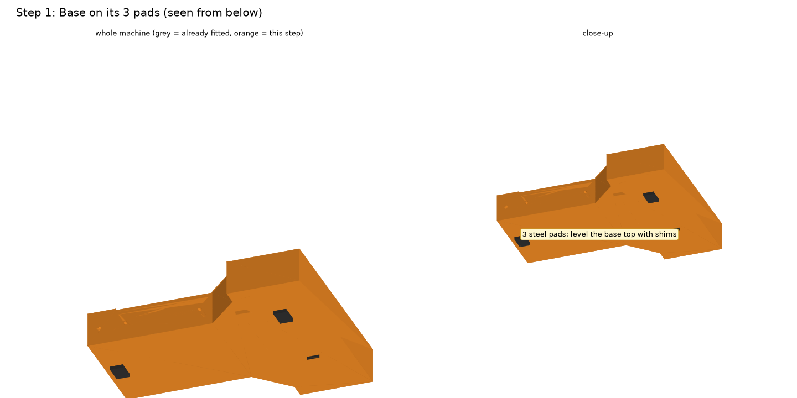
- **Fit:** the base casting on 3 steel pads on the bench (2 at the back, 1 at the front).
- **Line up:** shim under the pads until the base top is level both ways.
- **Check:** level (X02) along and across the spine. It doesn't have to be perfect; it just makes the next measurements easier.
- **Before step 2:** the rail-seat pour. Thin Ampreg resin is poured into the 5 mm recess over each Y insert bar and finds its own level. Then cure and post-cure (D-122).

## Step 2: Y rails
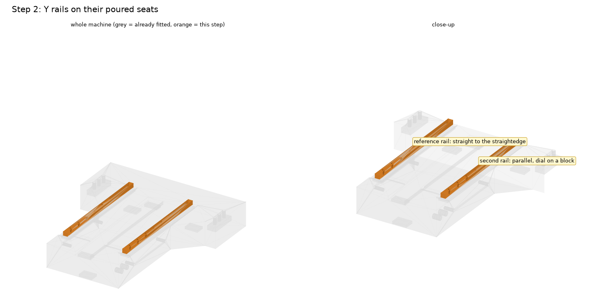
- **Fit:** the 2 Y rails on their seats, bolts finger-tight (M5 × 20, open question 4b).
- **Line up:** the **left rail is the reference**. Clamp the straightedge beside it, push the rail against it and tighten from the middle outwards. Then set the right rail parallel: dial indicator on a carriage of the left rail, reading the side of the right rail, and adjust the right rail until the reading is the same along its length.
- **Check:** straightedge on each seat before the rail goes on (feeler under it). Dial reading along the second rail.

## Step 3: Y carriages and table
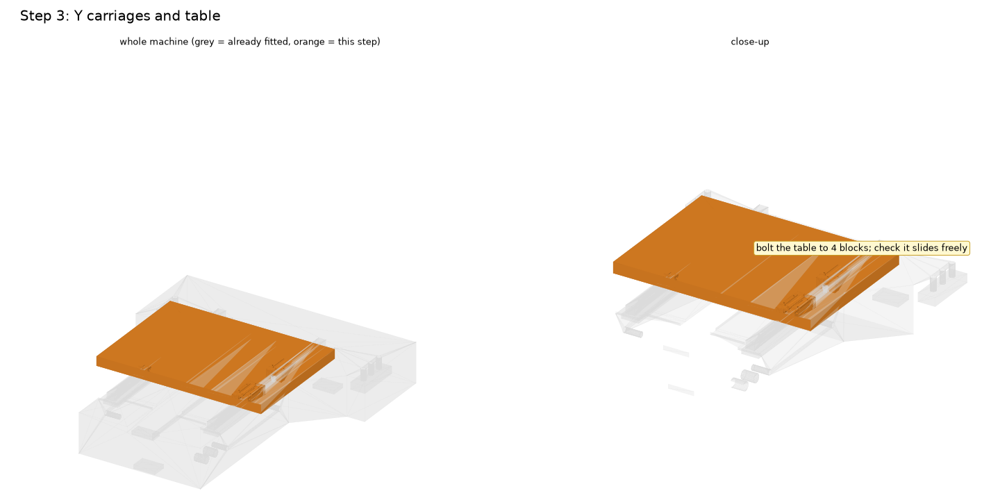
- **Fit:** 4 carriages, then the table on top.
- **Line up:** bolt the table to the 2 carriages on the left rail first, then the right ones.
- **Check:** push the table end to end by hand. It must move with the same light force everywhere. A tight spot means the rails are not parallel.

## Step 4: Y ballscrew
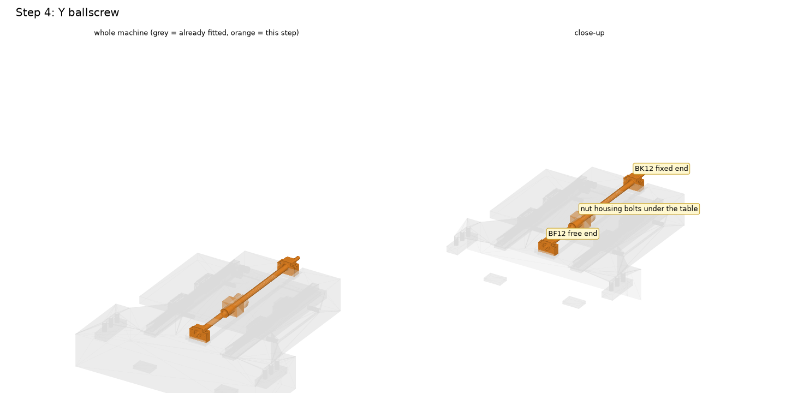
- **Fit:** BK12 (fixed end, front) and BF12 (free end) in the cast channel, the screw, its nut and the nut housing.
- **Line up:** bolt the nut housing under the table first, with the BK and BF bolts loose. Run the table to each end and tighten that end's support while it sits next to the nut. This makes the screw follow the carriages.
- **Check:** turn the screw by hand over the full travel. No tight spots.

## Step 5: Y motor and belt
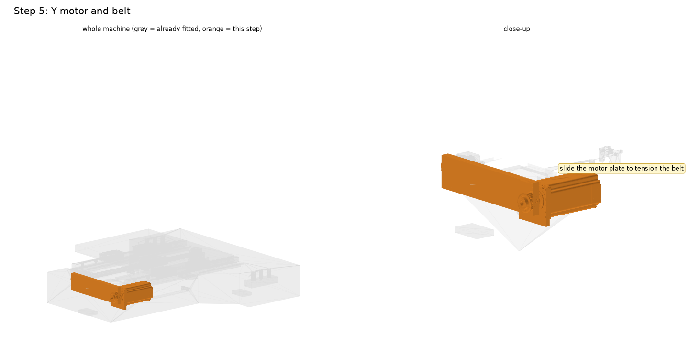
- **Fit:** pulley on the screw, motor on its plate alongside the spine, belt.
- **Line up:** pulleys in line (straightedge across both pulley faces). Slide the motor plate in its slots to tension the belt.
- **Check:** the belt runs centred on the pulleys with no edge rubbing.

## Step 6: Portal on the base
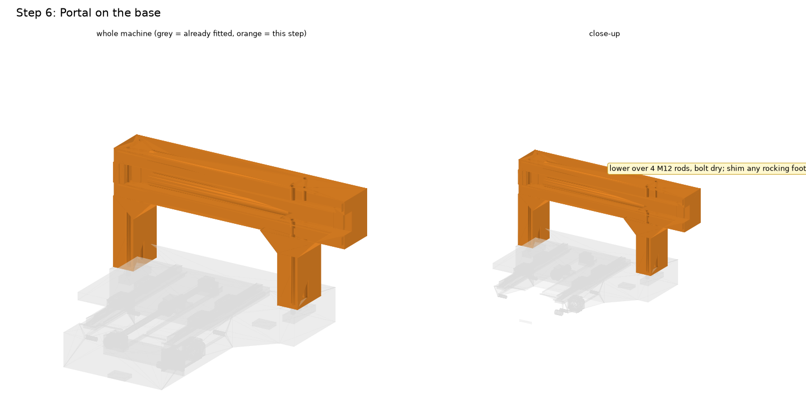
- **Fit:** lower the portal over the 4 M12 rods straight onto the base (no grout, D-132). Nuts only snug.
- **Line up:** roughly square by eye for now. Go round each leg foot with a 0.04 mm feeler. Wherever it goes in, slide a steel shim under that foot until the foot can't rock.
- **Check:** torque the nuts in a cross pattern, then the feeler again: no gap under either foot.
- **Before step 7:** the X rail-seat pour on the beam face, as in step 1.

## Step 7: X rails on the beam
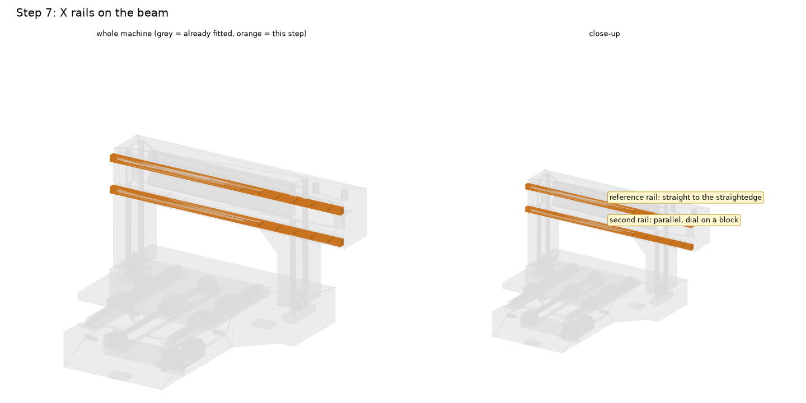
- **Fit:** the 2 X rails on the beam face.
- **Line up:** same as step 2. The **top rail is the reference** (straightedge), and the bottom rail is set parallel with the dial on a carriage.
- **Check:** as step 2.

## Step 8: X carriages and saddle, then square X to Y
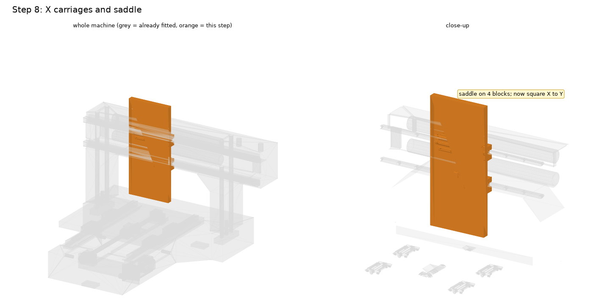
- **Fit:** 4 carriages and the saddle.
- **Line up, the squaring:** this is where X is made square to Y. Slacken the 4 portal nuts slightly, turn the portal a little on the base, and tighten again. Repeat until it is square.
- **Check:** engineer's square and DTI (see the note at the end).

## Step 9: X ballscrew
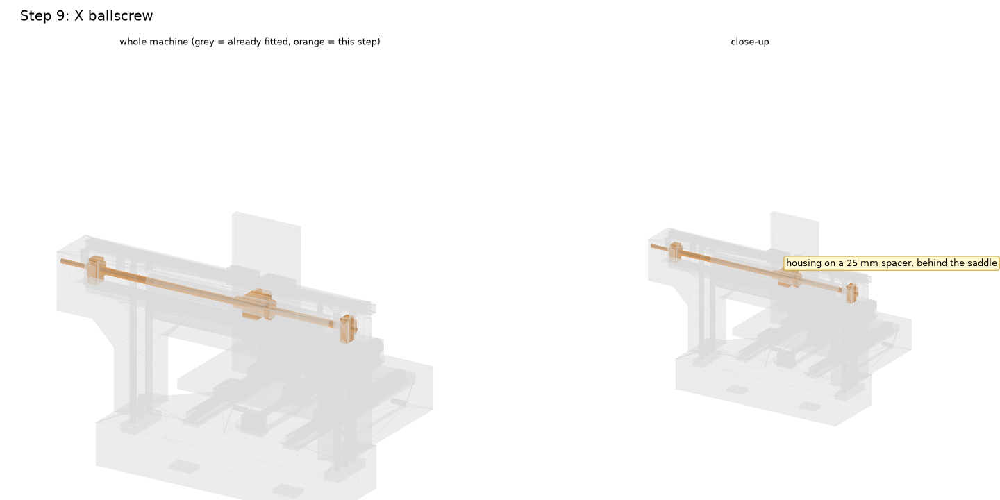
- **Fit:** BK12 and BF12 in the beam channel, the screw, the nut, and its housing on the 25 mm spacer behind the saddle.
- **Line up and check:** same as step 4.

## Step 10: X motor and belt
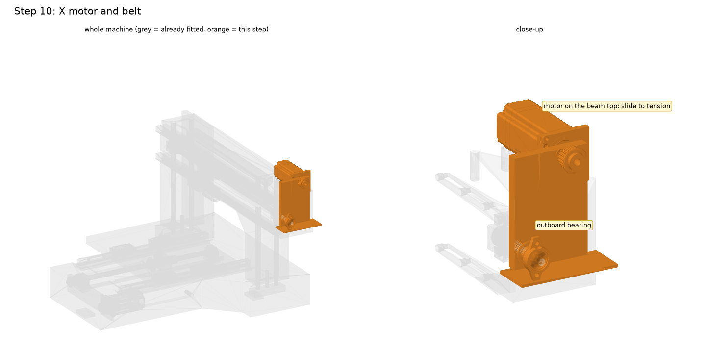
- **Fit:** pulley on the screw end past the beam, outboard bearing, motor on its plate on the beam top, belt.
- **Line up and check:** same as step 5. The outboard bearing goes on last, with its bolts tightened while the screw turns freely.

## Step 11: Z rails on risers
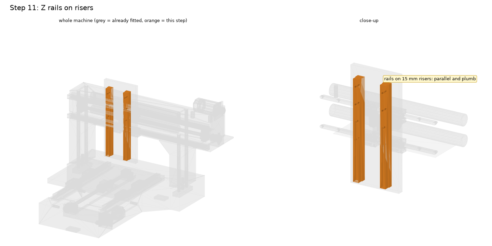
- **Fit:** 2 risers on the saddle, then the 2 Z rails.
- **Line up:** one rail is the reference (straightedge), and the other is set parallel with the dial, as in step 2.
- **Check:** both rails plumb: dial on the table, reading the rail face while Z moves (after step 12) or the level against the rail now.

## Step 12: Z plate, screw and motor
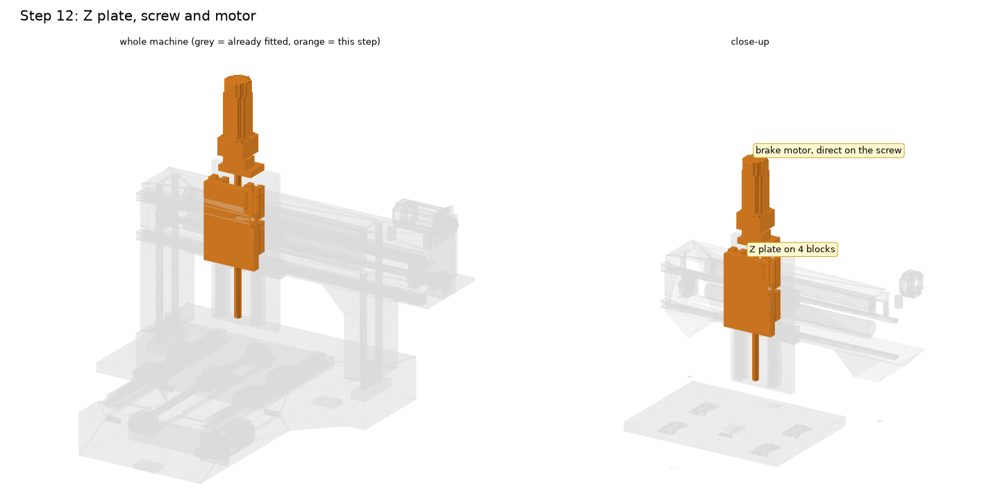
- **Fit:** 4 carriages, the Z plate, the nut and housing, BK12 on its bracket at the top, the screw, the coupling and the brake motor.
- **Line up and check:** same as step 4. Only a fixed end at the top on Z (no BF).

## Step 13: Spindle
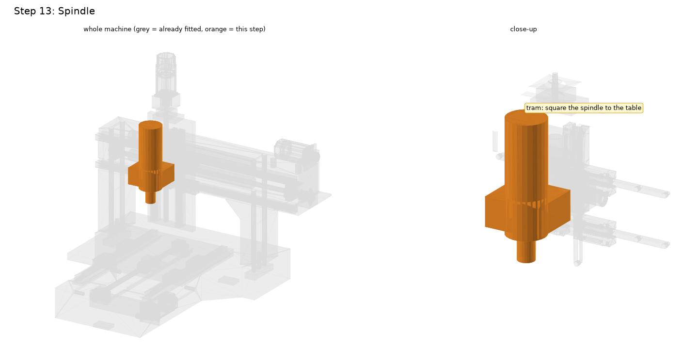
- **Fit:** the spindle clamp on the Z plate, then the spindle.
- **Line up, tramming:** dial indicator held off-centre in the spindle, swept round in a circle on the table. Equal readings front/back and left/right mean the spindle is square to the table. Shim behind the clamp to correct front/back.
- **Check:** the dial readings round the circle.

## Step 14: Home sensors
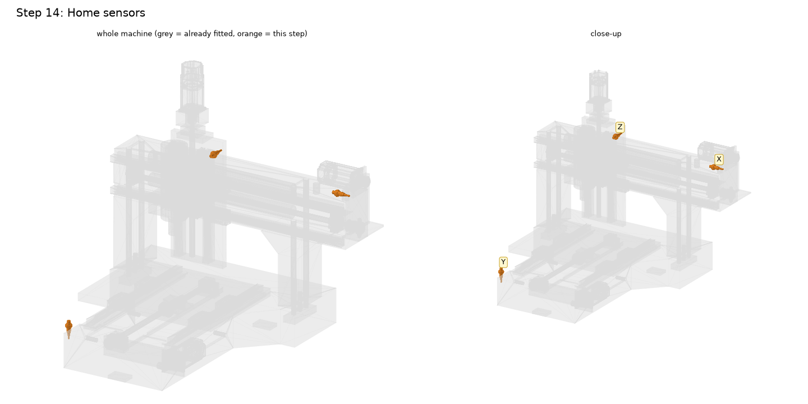
- **Fit:** 3 M12 sensors on printed brackets (X past the beam end, Y on the spine side, Z on the saddle).
- **Check:** each one's LED switches when its flag passes. Then the LinuxCNC bench tests (`docs/linuxcnc.md`).

---

## After a move (D-128, D-132)
The portal comes off, is carried up, and goes back on its 4 rods and the same shims (mark which foot each shim came from). Then **step 8 again** (square X to Y) and **step 13** (check the tram). Nothing else needs re-doing: the rails stay bolted to their castings.

## How to measure square (step 8, D-133)
With an **engineer's square** (X10) and the dial test indicator (X01): stand the square on the table, set its long blade parallel to Y with the DTI (run Y, tap the square until the reading stays still), then run X along the short blade. The change in the reading is how far X is out of square. Details: `portal-relocation.md`.
