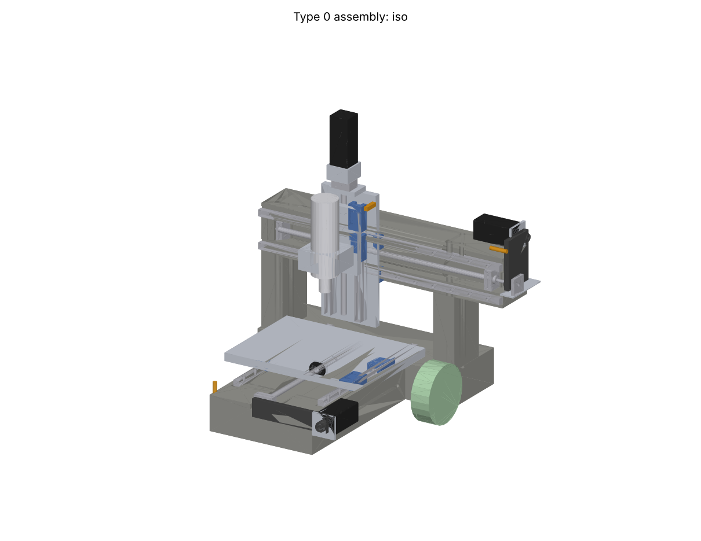

# Full CAD assembly (task 4, D-102 … D-110)

The detailed assembly the mould drawings (task 5) will come from. Built in CadQuery by the session; you refine it in **Fusion 360** and send back the final STEP (D-102).

| File (`cad/v2/out/assembly/`) | What |
|---|---|
| `type0_assembly.step` | Whole machine, about 80 named components with colours. **Fusion: File → Open** (keeps the component tree) |
| `base_casting.step`, `portal_casting.step` | The two castings alone, with every cast-in recess, channel, core and sleeve |
| `cast_in_features.md` | List of every insert, channel, core, sleeve and lifting point, with sizes and positions: the input to the mould drawings |
| `assembly_iso.png`, `_iso_back`, `_front`, `_side`, `_top` | Views |
| `assembly_data.json` | All derived numbers, masses, extents, clash results |

Regenerate: `python cad/v2/assembly.py` (about 2 minutes; checks clashes at 3 axis positions). The enclosure (`enclosure.py`) and the bench (`bench.py`) now size themselves from this assembly.

## What's in it

- **Castings:** base (T-shape, spine 340 × 725, 110 high, **78.2 kg**) and portal (800 wide, beam 150 high, **34.8 kg**), with every cast-in feature: rail insert bars and levelling recesses, screw channels with support seats and insert plates, PVC cores, joint sleeves, dowel sleeves, motor and ATC bracket inserts, lifting points.
- **Motion:** HGR20 rails with HGH20CA carriages on all axes; DFU1605 screws with BK12/BF12 supports and nut housings; NEMA 24 motors (Z with brake).
- **Drives:** X and Y folded with 1:1 HTD-5M belts; Z direct with a coupling.
- **Plates:** table 460 × 330 × 25; saddle 180 × 400 × 20; Z plate 140 × 200 × 20; Z rail risers; X nut-housing spacer; motor plates and brackets.
- **Spindle** with its 80 mm clamp, **home sensors** for X/Y/Z, and the **ATC wheel envelope** (Phase 2).
- **Clash check:** none at the centre, front-left-bottom and back-right-top positions.

## Design changes found by the assembly (your decisions)

| D | Change | Why |
|---|---|---|
| D-104 | Beam 130 → **150 high**, X rails **100 apart**, X insert bars **25 × 10**, X screw between the rails | The X screw supports (60 wide) and nut housing (40 deep) didn't fit between rails 80 apart. Portal stays under 40 kg |
| D-105 | Spine 320 → **340 wide** | 40 mm Y insert bars ended flush with the spine sides; now 10 mm cover |
| D-106 | Spindle axis **175 mm** in front of the beam (Y −65); spine **65 mm longer** at the front | The real plate stack (rails, saddle, risers, Z rails, Z plate, clamp) |
| D-107 | **X and Y motors folded** with 1:1 HTD-5M belts. Y: fixed support at the spine front, belt just in front of the spine face, motor alongside the right spine face under the table. X: motor on the beam top, pulley past the beam end with an **outboard bearing** | Direct X stuck out of the enclosure by about 135 mm; folded Y keeps the enclosure about 840 deep. Belts can't cross the Y rails or pass through the beam, so the pulleys sit beyond the casting ends |
| D-108 | X nut housing on a **25 mm spacer**; X channel **45 deep** with 5 mm seat pads | Otherwise the X supports hit the carriages near the ends of travel |
| D-109 | Z: **direct drive on top**, tall saddle (400) carries the Z rails on 15 mm risers, short Z plate (200) moves. Enclosure now **921 × 836 × 898 outside** (was 904 × 954 × 754) | Your choice; the brake holds Z directly. Fits the 1000 × 1000 bench |
| D-110 | Purchases change (see below): price check 12 | Follows from the above |

## Purchases that change (price check 12)

| BOM | Was | Now |
|---|---|---|
| M05 ballscrews | X 750 / Y 450 / Z 350 | **X 800–850 / Y 600 / Z 350**. Needed lengths: X 807, Y 577 overall. The "Guide Length" question decides X 800 or 850 |
| F07 flat bar | 40 × 10, 3 m | **40 × 10 about 2 m** (Y bars, portal joint bars, support plates) + **25 × 10 about 2 m** (X bars, ATC bar) |
| M12 plates | saddle 180 × 160 × 20, Z plate 140 × 320 × 20 | **saddle 180 × 400 × 20, Z plate 140 × 200 × 20**, + X spacer 52 × 52 × 25, Z risers 2 × 25 × 15 × 350, motor plates and brackets (about 10 mm plate) |
| M08 couplings | 3 | **1** (Z only) |
| M13 motor mounts | 3 bought brackets | Z: 1 NEMA 24 mount (check the 50 mm hole spacing, below). X/Y: belt motor plates (from the M12 plate order) |
| New | | **4 × HTD-5M 20T 15 mm pulleys, Ø10 bore**; **belts HTD-5M 15 mm, about 375 mm (X) and 525 mm (Y)** with slotted motor plates for tension; **1 × Ø10 flange bearing** (X outboard) |

## Things to check (VERIFY in the script)

- **NEMA 24 holes are 50 mm apart, not 47.1** (StepperOnline 24HS40-5004D-E1000 drawing). Any bought motor mount must match.
- Z motor (24HS34-5004D-E1000-B280) length with brake: drawing not reachable (assumed 85 + 38 + 25).
- HGH20CA height from the rail base to the carriage underside (H1, assumed 4.6).
- BK12/BF12: centre height (assumed 25) and bolt spacing (assumed 46). DSG16H housing width and length (assumed 52 × 52; centre 20 below the face is from its drawing).
- DFU1605 nut length (assumed 90) and flange flats (40).
- 80 mm clamp: spindle axis 60 from its mounting face (assumed; from the kit).
- HTD-5M 20T pulley size (assumed Ø31 × 21 + 8 hub).
- Home sensor positions are placeholders (envelopes only); the printed brackets (E27) get designed from these.

## Fusion 360 workflow

1. **File → Open → `type0_assembly.step`.** Each part comes in as its own component with its name (e.g. `X_BK12`, `base_casting`, `portal_insert_X_rail_T`).
2. Replace the envelopes with vendor models where you can download them (most need a free login):
   - HGR20 rail and HGH20CA carriage: HIWIN (hiwin.de, CAD download) or TraceParts
   - BK12/BF12, DFU1605, DSG16H: TraceParts / Misumi (Misumi has BK12 and HTD pulleys)
   - Motors: StepperOnline product pages (STEP under "Download")
   - D26 L35 coupling, HTD-5M pulleys: Misumi or TraceParts
   - Keep the envelopes for the spindle and clamp (no vendor CAD).
3. Detail the brackets, plates and sensor mounts in Fusion (the session's are simple blocks).
4. **Don't move the castings' cast-in features without telling the session**: the mould drawings come from them. Changes go back into `assembly.py` so the numbers stay in one place.
5. Export **File → Export → STEP** and upload it here. Task 5 (moulds) starts from that file.
