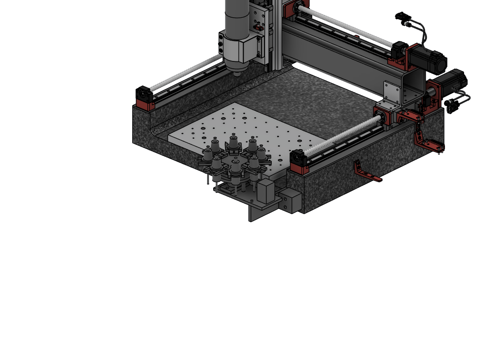

# ATC wheel (Phase 2): as modelled (22 Nov 2026, D-250 to D-252)

The ATC wheel is modelled in `Type_0_v3` as the top-level component `ATC Wheel (Phase 2)`. It is a horizontal umbrella wheel (D-138) at the front right, entirely in front of the tub. **The model is not saved.**

## Layout (world mm, Y = 0 at the rail front ends, tub front face Y -37)

| Item | Where |
|---|---|
| Pickup (spindle axis) | X 200, Y -85. Y stop -88, so 3 to spare; X stop +207.5 |
| Wheel centre | X 200, Y -174, vertical Ø20 shaft |
| Pockets | 8 at 45°, pitch radius 89; the pickup pocket opens towards +Y |
| Forks | 8 thick, Z 167 to 175, on a Ø128 x 8 6082 hub disc (Z 159 to 167), 2 x M5 each |
| Holders (stand-in ISO20-ER16) | flange Ø45 over and under the fork, groove Ø36 in it, pull stud top Z 225, body to Z 130, tool to Z 85 |
| Bracket | wall block 60 x 50 x 60 on the right wall front face (2 x M6 x 40 into the D-251 strip); 10 x 60 arm on edge from the block back to Y -224 (4 x M6 x 25); 10 bearing plate Z 60 to 70 (3 x M5 x 20 into the arm's top edge); Ø120 top plate Z 115 to 125 on 2 Ø12 posts |
| Bearings | 2 x KFL004: one on the bearing plate (Z 70 to 96), one on the top plate (Z 125 to 151) |
| Drive | NEMA 17 closed loop (A03) face down on the bearing plate at X 342, outside the hanging tools; GT2 20T/60T under the plate, centres 142 (belt about 366, A08) |
| Index | LJ12A3 M12 (A09) through the top plate at 225°, r 50, 2 below a flag under the hub |
| Cast in (Phase 1) | steel strip 25 x 10 x 50, X 337.5 to 362.5, Z 5 to 55, M6 tapped at Z 15 and 45, Ø6.6 core 2 deep behind (D-251) |

Aluminium and shaft about 2.2 kg. Every bracket part is below Z 85, so it stays under the hanging tools.

## Tool change sequence (as the clearances allow)
1. Drop-off: Z up, go to X 200, Y -55, nose down to Z 181 (in front of the tub, the tool tip at Z 85 is 15 above the plate).
2. Slide -Y to Y -85: the holder's groove enters the empty pickup fork.
3. Release, lift the nose to Z 232 (holder top is Z 225). Index the wheel to the wanted pocket.
4. Pick-up: nose down to Z 181 over the holder, clamp, slide +Y to Y -55, Z up.

## Clash check (22 Nov 2026)
Copies of the Z axis bodies (spindle, clamp, Z plates, X blocks) were moved to four places and intersected with every ATC body: approach Y -55 nose 181 carrying a holder, pickup Y -85 nose 181, lifted Y -85 nose 232, lifted Y -55 nose 232. The joints could not be driven from a script, so the copies were moved instead. **No clash.** The ATC against the rest of the machine at rest: no clash. The only overlaps are screws in their tapped holes.

| Gap | mm | How found |
|---|---|---|
| Y pickup to the Y stop | 3 | model limits |
| Nose lifted (232) to the top of Z travel (245) | 13 | model limits |
| Nose lifted to the holder tops (225) | 7 | sizes |
| Spindle body (Ø81) to the neighbouring tapers | about 11 | sizes |
| Nose (181) to the neighbouring flange tops (179) | 2 | sizes |
| Hanging tool tips (85) to the fixture plate (70) | 15 | sizes |
| Motor to the 0° holder body | about 18 | sizes |

## Not done or not known
- Forks, holders, bearings, collar and motor are stand-ins (D-252). Real ISO20 holder sizes and the Jianken nose shape decide the 2 and 7 mm gaps: check them when the drawing comes.
- Tool length limit: the stand-in tools end at Z 85, 15 above the bearing plate under the side pockets (Z 70). A tool reaching more than 60 below the holder body hits it. Go down only in front of the tub (Y -55): at nose Z 181 the tool tip is only 15 above the fixture plate.
- The bench under the wheel is not modelled. The lowest ATC part (block and arm) is at Z 0, 15 above the tub bottom, so a flat bench top level with the tub bottom clears it.
- A05 (tool setter) has no place yet. The enclosure must now reach about 265 in front of the tub.
- Bracket stiffness is not calculated. The 220 bearing plate is held only on the arm's top edge.
