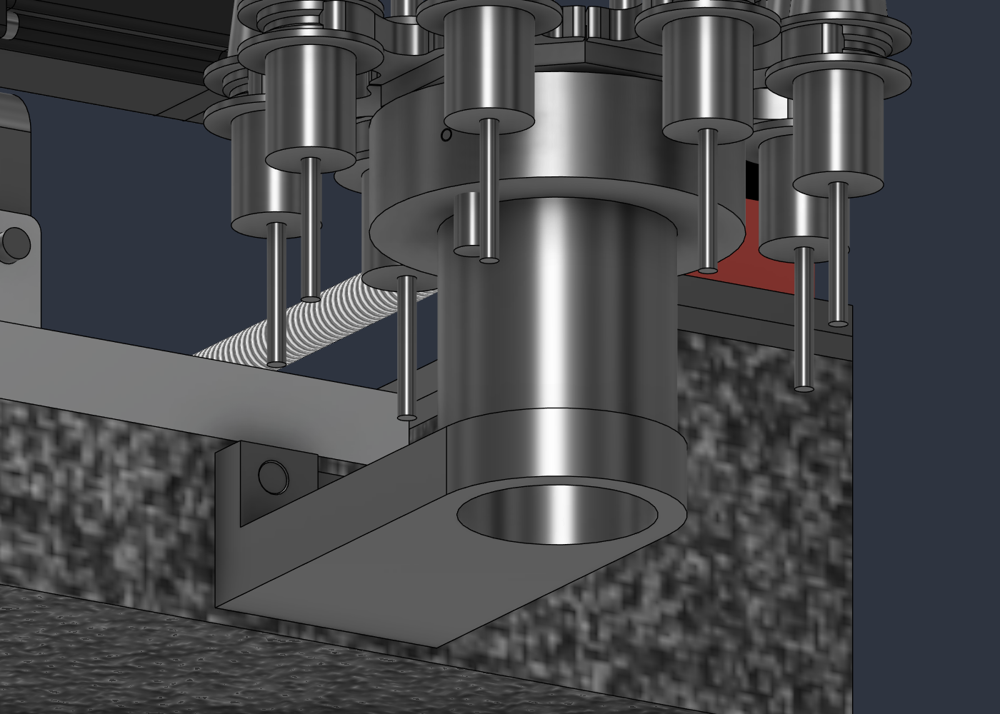

# ATC wheel (Phase 2): as modelled (23 Nov 2026, D-289 to D-293)

The ATC wheel is the top-level component `ATC Wheel (Phase 2)` in `Type_0_v3`. It is a horizontal umbrella wheel (D-138) in front of the tub, on the spindle's pickup line X 200 (D-253). Direct drive with a rigid joint (D-254), the owner's forks (D-255), 8-flat hub (D-275). **Since D-289 it stands on one machined 6082 mount**, 40 lower than before, on 2 x 6804 bearings (D-290). Design: `superpowers/specs/2026-11-23-atc-one-piece-mount-design.md`. Modelled 23 Nov 2026 (13th session); the 4 faults found after were fixed in the 14th session (D-291 to D-293). **Not saved: the owner saves.**

**Faults found after the 13th session's clash check, fixed 23 Nov (14th session):** (1) motor could not go in: the Ø62 pocket is now cut down through the arm (Z -10 to 81); the motor (42 square, 59.4 across corners) goes in from below, before the mount goes on the tub. (2) the Z 0 flange screws were buried: holes and counterbores filled in the mount, strip holes and tub cores filled, 2 screws removed (D-291); 2 x M6 at Z 30 stay. (3) the flag hit the web: web top recessed Z 115 to 119 from r 30 to the edge, boss top Z 118.5 (r 16 to 30), hub underside relieved 0.5 from r 11.5 to 17 (D-293). (4) the sensor nut did not fit: web hole now Ø11 tapped M12 x 1, sensor screwed in from below, locked by an M4 x 8 nylon-tip grub from the web edge (D-292). Also found by the sweep: 2 M10 x 30 screws and 2 M10 nuts of the old KFL004 (in `Joint screws added (D-262)`) were still in the model, through the hub and forks: removed. **Still open:** no room for a retaining ring under the lower bearing inside the Ø22 pilot, so only the M4 grub holds the wheel down.

## Layout (world mm, Y = 0 at the rail front ends, tub front face Y -37)

| Item | Where |
|---|---|
| Pickup (spindle axis) | X 200, Y -85. Y stop -88, so 3 to spare |
| Wheel axis | X 200, Y -174 |
| Pockets | 8 at 45°, pitch radius 89; the pickup pocket opens towards +Y |
| Forks (owner's model) | Z 126 to 136, V rib mid-plane **Z 131**; 1 x M4 x 12 countersunk each into the hub at r 41.7 |
| Hub (`ATC Hub with spigot`) | 8 flats 101.6 across x 12, Z 119 to 131 (underside relieved to Z 119.5 from r 11.5 to 17, so it bears on the bearing inner ring only), 8 x M4 tapped (D-275), **with a Ø20 spigot Z 84 to 119** machined on; bored Ø5 from below (Z 84 to 107) for the motor shaft; M4 x 6 grub at Z 86.5 along +X |
| Bearings | 2 x 6804-2RS (20 x 32 x 7) stand-ins, Z 89 to 96 and 112 to 119, spacer Ø32/26 x 16 between (D-290) |
| Mount (one body, 6082) | Web Ø116, Z 81 to 119: Ø32 bearing bore Z 89 to 119, Ø22 motor pilot Z 81 to 89, 4 x Ø3.4 motor holes (31 square) with Ø6 counterbores down to Z 89, Ø5 grub access along +X at Z 86.5, sensor hole Ø11 tapped M12 x 1 at 202.5°, r 44, with an M4 tapped hole from the web edge at Z 98 (D-292). Top: boss Z 118.5 (r 16 to 30), recessed to Z 115 from r 30 to the edge (D-293). Cup Ø74, Z 12 to 81; pocket Ø62 through from Z -10 to 81. Arm 80 wide (X 160 to 240), Z -10 to 12, rounded Ø80 at the axis (9 wall round the pocket). Flange X 160 to 240, Y -52 to -37, Z -10 to 40, 2 x Ø6.6 with Ø11 x 6.5 counterbores at X 172 and 228, Z 30 (D-291); notch X 188 to 212 above Z 12. Box X 142 to 258, Y -232 to -37, Z -10 to 119; 675 cm³ (about 1.8 kg) |
| Holders (stand-in ISO20-ER16) | Ø45 flanges above and below the fork, top Z 185, body to Z 90, tool Ø6 to Z 45 |
| Drive | NEMA 17 closed loop (A03) face up under the web, Z 13 to 81; 4 x M3 x 12 from the top through the web. Order: motor up through the open pocket, M3 screws from the top, lower bearing, spacer, upper bearing, hub onto the shaft, grub through the access hole; then the mount onto the tub (2 x M6 from the front, 85 clear for the key between the flange and the cup) |
| Index | LJ12A3 M12 (A09) screwed into the tapped web at 202.5°, r 44 (Z 64 to 114), 1 clear of the cup; M4 x 8 grub locks it (D-292). Flag under the hub (Z 116 to 119): 1 above the recess floor, 2 above the sensor face |
| Cast in (Phase 1) | steel strip **80 x 10 x 50**, X 160 to 240, Y -37 to -27, Z -10 to 40, 2 x M6 at X 172 and 228, Z 30; Ø6.6 cores Y -27 to -25 behind each hole. Old 25 wide strip and its 2 cores removed and filled; Z 0 holes and cores filled (D-291). 2 x M6 x 20 hold the flange |

Envelope: X 88 to 312, Y -286 to -25, Z -10 to 185. Parts from the tub face to the hub: mount, 2 bearings and spacer, hub (was 9 parts plus a shaft).

## Tool change sequence
1. Drop-off: Z up, go to X 200, Y -55, nose down to **Z 141** (in front of the tub).
2. Slide -Y to Y -85: the holder's groove enters the empty pickup fork.
3. Release, lift the nose to **Z 192** (holder top is Z 185). Index the wheel to the wanted pocket.
4. Pick-up: nose down to Z 141 over the holder, clamp, slide +Y to Y -55, Z up.

## Sweep check (23 Nov 2026, 14th session, after D-291 to D-293)
Turning parts rotated about the wheel axis (X 200, Y -174) and intersected with every visible static body in X 75 to 325, Y -300 to -15, Z -15 to 200 (mount, bearings, spacer, motor, sensor, all ATC screws, tub, strip, steel plate, levelling pour, fixture plate, Y ball screw parts): hub, 8 forks, 8 fork screws, 8 holders and tools 0 to 45° in 3° steps (8-fold); flag and hub grub 0 to 360° in 5° steps. Threshold 0.1 mm³.
- **Result: no hits** (after removing the 4 leftover KFL004 M10 parts, which the first run found).
- Static against static: only screws in tapped holes (2 M6 in the strip, 4 M3 in the motor, M12 sensor thread, M4 sensor grub).
- Not covered: the spindle against the wheel was not re-run (the wheel and holders did not move; 13th session result below stands).

## Clash check (23 Nov 2026, 13th session, after D-289): overlap in one pose only
This check did not cover access, assembly or the turning hub; it missed faults 1 to 4 at the top (now fixed).
Copies of the 23 Z moving bodies near the spindle were moved by dX 421.8, dY -352 or -382, dZ -29 or +22 (approach, pickup, lifted at both Y) and intersected with every ATC body.
- **Spindle against the wheel:** the only hits are 2 Z-side bodies with holder 1, the pocket that is empty at the drop-off and gripped at the pick-up (as on 22 Nov). Lifted at Y -85 and Y -55: no clash.
- **Wheel turning (holders and tools only, not the hub and flag):** copies of all 16 holders and tools rotated 0 to 45° in 3° steps against the mount, the sensor, the motor and the flange screws: no clash.
- **ATC against the tub and fixture plate:** no clash; only the 4 M6 x 20 in the strip.
- Inside the ATC: only screws in tapped holes (M4 fork screws, M3 into the motor, grub into the spigot). Hub against the forks: 2.6 mm³ each, a 0.01 mm touch at the flats.

| Gap | mm | How found |
|---|---|---|
| Y pickup to the Y stop | 3 | model limits |
| Nose lifted (192) to the top of Z travel (245) | 53 (was 13) | sizes |
| Nose lifted to the holder tops (185) | 7 | sizes |
| Nose (141) to the fork tops (136) | 5 | sizes |
| Tool tip (45) to the arm top (12) | 33 | sizes |
| Tool length below the fork, max | about 114 (fork 131, arm 12, 5 clear); was about 98 | sizes |
| Motor bottom (13) to the arm underside (-10), pocket open | 23 | sizes |
| Motor screw counterbore to the bearing bore | 2.9 wall | sizes |

## What is and is not checked
- **Tilt:** the 2 x 6804 (centres 23 apart) carry a fork push of F at r 89 as about 3.9 F on the bearings; the motor shaft no longer carries it. Not calculated: the bearings' rating against the real drawbar and clamp forces.
- **Motor runout (open):** the rigid joint on 2 bearings is over-constrained by the motor's own pilot-to-shaft runout. The bore and pilot are machined in one set-up; measure the real motor.
- **Index error at the fork:** 4000 counts per turn (not confirmed) is 0.09°, about 0.14 mm at r 89. Check on the bench.
- **Inertia:** use a low acceleration in the ATC macro.
- **Motor length:** 68 body assumed. The pocket is now open through the arm, so a longer motor (to Z -10 and below) fits.
- **Making it:** 129 tall against 175 nose-to-table on the Type 0, 68-deep pocket. Cut it lying down, or order from JLC (D-272, D-289).
- **Arm stiffness:** 80 x 22 section, about 85 from flange to cup. Not calculated.
- **Plate edge at the approach:** at Y -55 the tool (Ø10 max for ER16) clears the plate edge (Y -37); holder and collet nut stay above Z 70 there (body bottom Z 90).

## Not done or not known
- Holders, bearings and motor are stand-ins (D-252). The real ISO20 holder and the Jianken nose decide the 5 and 7 mm gaps.
- Spigot retaining ring under the lower bearing (Z 84 to 89) not drawn.
- The bench under the wheel is not modelled; the lowest ATC part is Z -10.
- A05 (tool setter) has no place yet. The front slot (X ±107.5) still overlaps the keep-out (X 88) by 19.5.
- `Type_0_v3` not saved: the owner saves.
