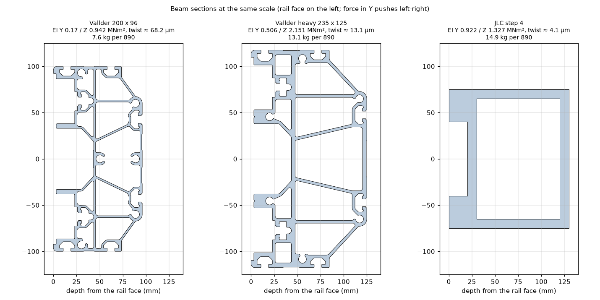

# Beam: Vallder CNC extrusion instead of the JLC U channel? (17 Nov 2026, measured)

**For the owner to choose. Nothing decided; D-147 stands until then.** First pass (estimates) earlier on 17 Nov; this pass uses the owner's Vallder downloads (question 2 answered): the two section DXFs are now `cad/vendor/vallder_200x96.dxf` and `cad/vendor/vallder_heavy_235x125.dxf`. The two STEP models (95 MB and 47 MB) are not in git; the heavy STEP was used only to check the rail and screw positions.

Script: `PYTHONUTF8=1 python cad/v2/vallder_profiles.py` (numbers in `cad/v2/out/vallder_profiles.json`). Same load model as `beam_options.py`: span 690, 200 N at mid-span, tool 245 below the beam centre. The JLC step-4 beam (30 mm front wall, 80 × 20 channel, back plate bonded) goes through the same routine.

## Measured

| | 200 × 96 | Heavy 235 × 125 | JLC step 4 |
|---|---|---|---|
| Mass per m (DXF; Vallder states) | 8.53 (8.20) | 14.77 (14.80) | 16.74 |
| Beam 890 long | 7.6 kg | **13.1 kg** | 14.9 kg mid-section, **17.8 kg** with the solid ends |
| **EI, force in Y** (cutting) | **0.17** | **0.51** | **0.92** |
| EI, force in Z (plunge) | 0.94 | 2.15 | 1.33 |
| Y deflection, 200 N | 8.1 µm | **2.7 µm** | **1.5 µm** |
| Twist at the tool (estimate, Bredt, walls read off the DXF) | about 68 µm | **about 13 µm** | **about 4 µm** |
| Metal price, 890 long | £69.82 | £101.75 | not priced (STEP quote) |

- **The first pass over-stated both profiles.** Its pick was the heavy profile "if its drawing confirms EI near 1". **It measures 0.51, so that condition fails.** In Y it sits between stock tube B2 (0.35, `beam-assessment.md`) and the JLC beam.
- **Twist is the bigger gap.** Most of the metal is in the open front (T-slots, screw channel). The closed cells behind have walls only 2–4.5 mm thick, against the JLC beam's closed 10 mm box. The estimate ignores the internal webs, so it is rough, but the ratio (about 3×) is clear.
- **The 200 × 96 is out:** 5× softer in Y than the JLC beam and about 17× worse in twist.
- **EG fill (D-147, not now):** filling the heavy profile's cells adds **29 kg** (moving mass about 80 kg), as box C did. No help.

## Heavy profile: how our parts would sit (DXF and Vallder's STEP)

- **Rails** sit in 3 mm deep grooves, about 21 wide: **155 apart** (not 100, D-104). The groove side gives a datum edge, so no machined shoulder is needed. The seats are as-extruded anodised faces (question 4).
- **Saddle:** the block outer edges come to 199 across. The saddle is 400 tall (`assembly.py`), so it fits.
- **Saddle face:** the rails are sunk, so the block tops stand only **4 mm proud of the profile's front lips** (30 mm on the JLC beam). From the saddle back to the beam centroid: **63 mm**, against 90 on the JLC beam. That shortens the spindle overhang (D-106) by about 27 mm, partly offsetting the weaker twist. The feet would be redrawn: the profile is 235 tall × 125 deep (JLC: 150 × 130).
- **X nut housing (DSG16H)** straight on the saddle: screw axis 16 mm behind the lips, housing back **7.6 mm clear** of the channel floor. The channel is 76 wide. It fits.
- **BK12 / BF12 in the channel** (keeps the 700 screw, step 4): the channel floor is 43.6 mm behind the lips, so the supports need a **2.6 mm pad**. **But the floor is only 4 mm thick, over a hollow cell.** M6 tapped into 4 mm of 6063 gives about 4 threads, which is too weak. The way to make it work is a tapped steel strip slid into the cell from the profile end (the supports sit about 120 mm in from each end), bolted through the floor. Otherwise the supports go on end plates as Vallder does: screw 952, over the 950 DDP limit, and a re-buy of the 700 screw.
- **Beam to feet:** end plates bolted into the profile's end holes (Vallder's way). Not drawn yet.

## My pick

**Keep the JLC channel (D-147).** It is 1.8× stiffer in Y and about 3× stiffer in twist, its rail faces are machined, and the X screw and rail bolts go into solid metal. The heavy profile is 4.7 kg lighter and has a known price. It stays the **fallback if the JLC quote is far above about £100 plus shipping**. It would also need answers to questions 3 and 4 below and a steel strip for the BK12/BF12.

## Questions for the owner

1. **Which beam:** keep the JLC channel (my pick, then step 4 goes ahead with the 7 questions in `task22-step4.md`), or the heavy 235 × 125?
2. ~~Vallder's 2D/3D files~~: done, thank you (this page).
3. Only if the heavy profile is chosen: **shipping**. Does Vallder ship to the UK, and at what cost? Please check at their checkout; curl can't do a checkout.
4. Only if the heavy profile is chosen: **rail seats**. Epoxy replication, a local skim, or rails bolted straight onto the as-extruded faces?
