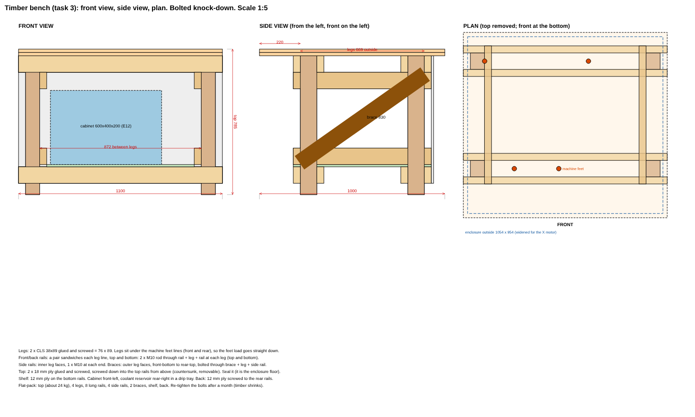

# Timber bench (task 3, D-97)

Model and drawings: [`cad/v2/bench.py`](../cad/v2/bench.py) → `cad/v2/out/bench_views.svg` (front, side, plan), `bench.step`, [`bench_cutlist.md`](../cad/v2/out/bench_cutlist.md). Change the numbers at the top of the script and re-run to update everything.

## Brief
- Top **1,100 × 1,000 mm** at **785 mm** above the floor (D-75), so the table top is at about 950 mm.
- Carries the machine (about 112 kg of castings plus about 40 kg of motion parts, spindle and table) and the enclosure (12 mm MDF, about 40 kg). Design load about 200 kg.
- Electrical cabinet (600 × 400 × 200, E12) on a shelf underneath (D-37), plus the coolant reservoir.
- **Bolted knock-down** (owner choice): it must come apart flat to go upstairs to the flat. Heaviest piece is the top at about 24 kg.
- Machine only on the top (owner choice). The PC, monitor and keyboard go on a separate table or shelf.
- **Why 1,100 wide:** the X motor sticks out about 170 mm past the right end of the portal beam (VERIFY when the parts arrive). The enclosure has to grow to about 1,054 × 954 outside, so the top is 1,100 wide (owner choice, 2026-11-15). The enclosure redesign itself is an open question (Phase 2).

## Design
| Part | Material | Notes |
|---|---|---|
| Legs (4) | 2 × CLS 38 × 89, glued and screwed = 76 × 89 | 749 long. Set 38 mm in from the sides (room for the braces) |
| Front/back rails (8) | CLS 38 × 89, 1,100 long | A pair sandwiches each leg line, at the top (under the top) and at the bottom (under the shelf). 2 × M10 through rail + leg + rail at each leg |
| Side rails (4) | CLS 38 × 89, 745 long | Inner leg faces, high (below the top rails) and low (above the shelf). 1 × M10 at each end |
| Braces (2) | CLS 38 × 89, 830 long | Outer leg faces, front-bottom to rear-top. Stop the bench racking front to back |
| Top | 2 × 18 mm ply, 1,100 × 1,000, glued and screwed | Screwed down into the top rails from above (countersunk). **Seal it**: it is the enclosure floor |
| Shelf | 12 mm ply, 796 × 745 | Rests on the 4 bottom rails, top at 162 mm |
| Back | 12 mm ply, 1,100 × 688 | Screwed to the rear rails. Stops the bench racking side to side |

**Legs under the machine feet.** The front legs sit on the front feet line (265 mm from the front edge) and the rear legs on the rear feet line (845 mm). Each pair of rails carries two machine feet straight into the legs. The top overhangs 220 mm at the front (enough for the enclosure's front wall and the e-stop) and about 70 mm at the back.

**Cabinet and coolant.** Cabinet at the front left of the shelf, door to the front, 498 mm of clear height (the cabinet is 400). Coolant reservoir and pump at the rear right, in a drip tray, away from the cabinet (D-37). Cables leave the enclosure through its rear slot and drop behind the back panel to the cabinet's bottom glands.

**E-stop 1** (D-91): on a small bracket under the front edge of the top, at the right.

## Load check
- Front feet carry the most (spine, table and Y motor at the front). Assume 50 kg on each front foot. A rail pair (2 × 38 × 89) over the 948 mm between leg centres, with both feet on it, bends about **0.4 mm** (C16 timber, E = 8 kN/mm²). The ply top stiffens it further. That is fine: the machine stands on its own levelling feet (T02), so the bench only has to be stiff, not flat.
- Legs: about 50 kg each in compression on 76 × 89. Negligible.
- Timber creeps a little under a constant load: re-level the machine feet after the first month.

## Build sequence (weeks 7–8)
1. Buy straight CLS (T03) and let it sit indoors for a week.
2. Cut all pieces from the cut list. Glue and screw the leg pairs (5 × 60 screws every 150 mm).
3. Drill the bolt holes **through each joint in one go**, with the parts clamped in place on a flat floor: Ø11 for M10. Number every joint with a marker so it goes back together the same way.
4. Bolt the two leg lines (front and back): legs + sandwich rails, top and bottom. Check each frame is square (equal diagonals).
5. Stand them up, bolt the side rails, then the braces. Check the bench doesn't rock; pack the feet with hardwood shims if the floor is uneven.
6. Glue and screw the two top layers together (weights on top while it cures). Screw the top down. Two coats of varnish or floor paint on the top and its edges.
7. Shelf and back panel. Fit the cabinet.

## Taking it apart
Top (unscrew), back panel, shelf, braces, side rails, then each leg line comes apart into 2 legs + 4 rails. Pieces: top about 24 kg, everything else under 10 kg. Keep the rod pieces, nuts and washers in a labelled box.

## Parts (BOM T03–T07, wave 2, all TO PRICE)
| ID | Item | Qty |
|---|---|---|
| T03 | CLS 38 × 89 × 2.4 m | 10 (9 + 1 spare) |
| T04 | 18 mm ply 2,440 × 1,220 | 1 (both top layers) |
| T05 | 12 mm ply 2,440 × 1,220 | 1 (shelf + back) |
| T06 | M10 rod 5 × 1 m, 50 nuts, 50 penny washers | 1 lot (24 bolts, 4.3 m of rod) |
| T07 | Wood screws, PVA glue, varnish | 1 lot |
