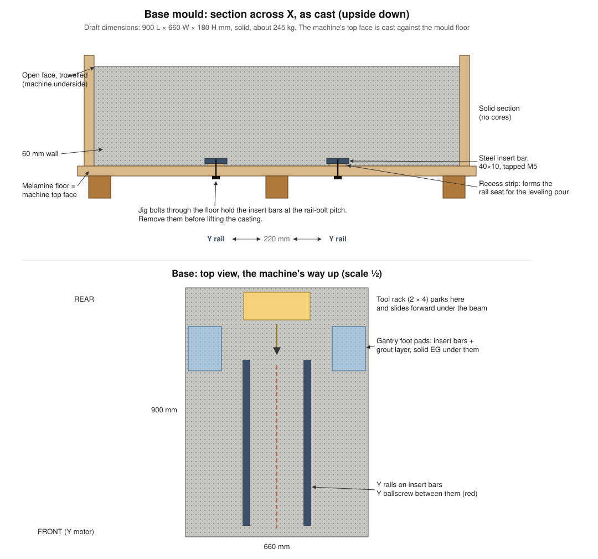
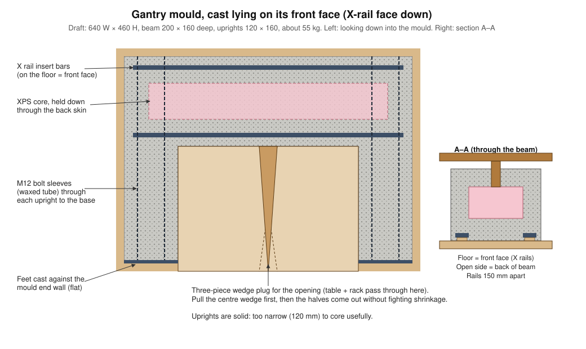

# EG moulds: fabrication and demoulding

> **Status:** draft for review. All dimensions are placeholders to make the drawings concrete. They will be fixed when we do the full layout.

## Draft sizes and mass (solid castings, D-30)

| Casting | Size (mm) | EG mass | Epoxy at 11% |
|---|---|---|---|
| Base | 900 L × 660 W × 180 H | about 245 kg | about 27 kg |
| Gantry | 640 W × 460 H; beam 200 × 160; uprights 120 × 160 | about 70 kg | about 8 kg |
| **Total** | | **about 315 kg** | **about 35 kg** |

Add about 3 kg of epoxy for the leveling pours, 1 kg for grout and 2–3 kg for test samples: **about 41 kg to buy**. The base alone is near the top of the frame-mass budget (200–350 kg). Check the stand design against about 400 kg in total, including the moving parts and the enclosure.

## The key idea: the mould floor is the jig

Each casting is poured **with its precision face down on the mould floor**:

- **Base:** cast upside down. The machine's top face is against the floor.
- **Gantry:** cast lying on its front (X-rail) face.

Everything that must be in the right place (rail insert bars, gantry foot pads, ballscrew bearing-block pads) is **bolted through the floor** with the real rail-bolt pattern drilled into it. The floor is one flat, drillable sheet. You mark it out on the bench before pouring, and the inserts can't drift during vibration.

The other side benefits too. Air rises when the mix is vibrated, so the floor-side face comes out the densest and cleanest. The rough open face becomes the underside (base) or the back (gantry), where finish doesn't matter.

Shallow **raised strips** on the floor (about 3–5 mm) leave recessed channels over each insert bar. Those channels later take the **self-leveling epoxy pour** that forms the rail seat. Link the two channels with a cross-channel so both rails settle at the same level.

## Hollow cores: assessment (not used, see D-30)

**Recommendation: closed cores (XPS foam left inside), not open channels.**

| Option | Stiffness | Effort | Verdict |
|---|---|---|---|
| Cores open to the underside (U-channel) | Poor in twist: an open section is many times less stiff in torsion than a closed box | Easiest: just lift the mould off | ✗ |
| **Closed XPS cores with a 40 mm bottom skin** | Keeps a closed box section, so most of the solid section's stiffness at about 65% of the weight | Needs hold-down posts | ✓ |
| Solid | Best damping | Most epoxy, most curing heat, about 230 kg base | Fallback |

How to make the cores:
- **Material:** XPS insulation board (the pink or blue kind), glued up in layers and cut to size. Its compressive strength (about 300 kPa) is far more than the EG pressure (about 4 kPa at 180 mm depth). Wrap the cores in packing tape so the epoxy can't soak in.
- **Buoyancy is the big risk.** Vibrated EG behaves like a heavy liquid (about 2,300 kg/m³). The three base cores add up to about 0.03 m³, which is **about 70 kg of upward force**. Hold them down with **posts from a batten** screwed across the top of the mould walls. Each post leaves a small hole in the bottom skin, which is useful for running cables and air lines.
- **Cross ribs** (60 mm) split each core row into segments, adding stiffness against twist. Keep **solid EG under the gantry feet** and under the motor and bearing mounts.
- **Gantry:** core the beam only. The uprights (120 mm wide) are too narrow to leave useful walls around a core.

### Evidence check (2026-11-04)

The owner asked for real examples before choosing cores. What I found:

- **PVC pipe cores** are well documented in DIY EG builds, mostly for cable and bolt channels and for ballscrew clearance ([model-engineer.co.uk](https://www.model-engineer.co.uk/forums/topic/diy-epoxy-frame-based-cnc-mill/), [lostzeros mini-mill](https://www.lostzeros.com/mini-mill-cnc-conversion-epoxy-granite-base-and-column-assembly/), [CNCCookbook](https://www.cnccookbook.com/epoxy-granite-cnc-machine-fill/)).
- **XPS foam cores** in DIY EG are rarely documented. One builder planned XPS cores to save epoxy and weight, but the result was never reported ([MyCNCUK thread 12972](https://www.mycncuk.com/archive/index.php/t-12972.html)). In the long CNCZone/CNCArena EG thread, one builder reported a 5×5×10 in foam core showing through the back of a test base, because the wall over it was too thin. I couldn't open that thread to verify the details.
- **Industrial mineral casting** does use hollow and weight-reduced structures ([Big Daishowa mineral cast catalogue](https://catalog.bigdaishowa.com/view/494013/129)), but there are no DIY details.

**Conclusion:** large closed foam cores are not a proven DIY method. The options are:
1. **Solid** (most proven. About 245 kg base, about 11 kg more epoxy).
2. **PVC pipe cores** (proven in DIY, smaller weight saving). A row of capped 75–110 mm pipes is easy to hold down and gives a closed section.
3. **XPS cores, but only after a test casting.** For example, cast a 500 mm beam with a core, then cut it in half to check for voids and core movement.

## Building the moulds

- **Material:** 18 mm melamine-faced MDF or ply. The floor sits on 40 × 40 mm battens every 300 mm or so, so it stays flat on the vibration table.
- **Joints:** screws only, **no glue**, so every wall comes off. Seal inside corners with a small fillet of silicone or plasticine, which also gives the casting rounded edges that resist chipping.
- **Release:** packing tape on cut edges, 3 coats of release wax, then PVA film. Test it on the sample moulds first.
- **Bracing:** batten the walls every 200 mm. Vibration makes unbraced walls bulge.
- **Inserts:** steel insert bars (40 × 10 mm, tapped M5 at the 60 mm rail-bolt pitch) with short welded studs or screws on the back to anchor them. Coat the jig bolts in wax.
- **Gantry joint:** waxed steel or PVC tubes form the M12 bolt holes through each upright. The upright feet are cast against a mould end wall, so they come out flat.
- **Gantry opening:** a **three-piece wedge plug** (two halves and a tapered centre wedge with 2° draft). The beam and uprights shrink onto it on three sides, so a one-piece block would be very hard to get out.
- **Lifting points:** cast M12 nuts on threaded rod into the open face, two or four per casting, for an engine crane.

## Pour and demould sequence

1. Mould on the vibration table, checked level and flat. Inserts bolted on. Temperature probes in place (see Thermal management).
2. Mix in small batches. Wet the aggregate with resin first, then vibrate while pouring in layers about 50 mm deep.
3. Cure **48–72 h at 18 °C or above** before demoulding. Allow about 7 days for full cure, or warm it to about 40 °C to speed it up.
4. **Remove the jig bolts through the floor first.** They hold the casting to the floor.
5. Remove the hold-down batten, then unscrew the walls. For the gantry, pull the centre wedge first, then the plug halves.
6. Lift the casting from the open-face lifting points and turn it over on a padded surface. The floor comes off last.
7. Inspect: tap the surface to find hollow-sounding voids, and check the inserts with a rail bolt.

## Risks

| Risk | Mitigation |
|---|---|
| Mould bulges | Battens every 200 mm. Run the vibration test with sand first |
| Resin leaks at corners | Silicone fillets and taped edges |
| Casting sticks to the mould | Wax + PVA. Test on samples. Screw-only joints |
| Opening plug jams | Three-piece wedge plug with draft |
| Warping or cracking from curing heat | See Thermal management |

## Thermal management (to research; owner is looking into this)

Solid sections up to 180–200 mm thick concentrate the curing heat. Starting points to verify:

- **The aggregate soaks up the heat.** At about 11% epoxy, most of the mass is stone, so the temperature rise is far smaller than for a pure resin pour of the same size. Measure it on the test bricks before relying on this.
- **Slow hardener** and a **cool, steady room** (about 15–20 °C). Avoid days when the garage gets very warm.
- **Pre-condition the materials.** Store the aggregate and resin in the same room for 24 h, so the starting temperature is known.
- **Measure it.** Cast thermocouples or cheap DS18B20 probes into the centre and near the surface of the base, and log the temperatures. Make the test bricks the same thickness (180 mm) as the real casting, so the peak temperature is representative.
- **Pour continuously, without stopping.** Pouring in stages can leave weak joints between layers. Mix in batches, but keep pouring.
- **Even cooling.** Leave the walls and insulation on until the peak has passed, so the surface and core cool together. This avoids stresses locked in by uneven cooling. Post-cure warm (e.g. 40 °C) only after the first cure.
- **Let it settle before the leveling pour.** Wait for full cure (about 7 days or more) before the rail-seat leveling pour, so the casting has finished shrinking.
