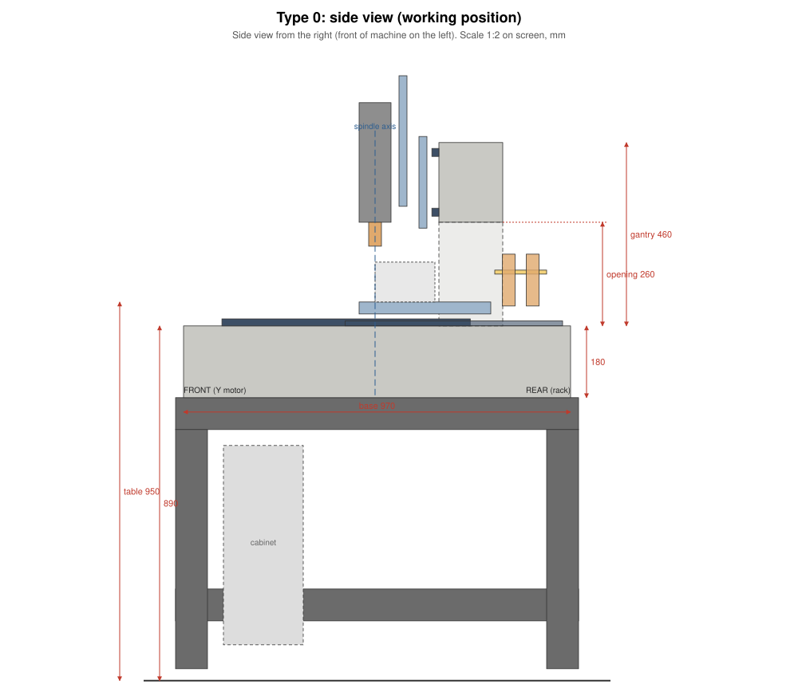
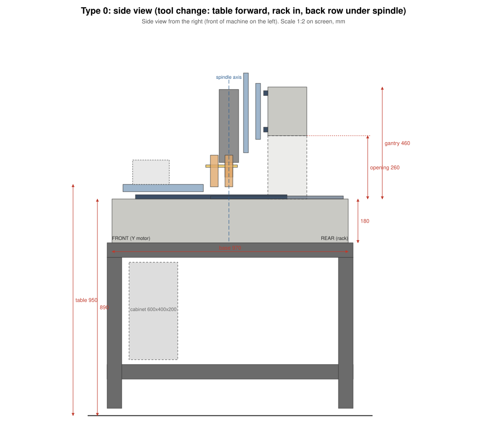
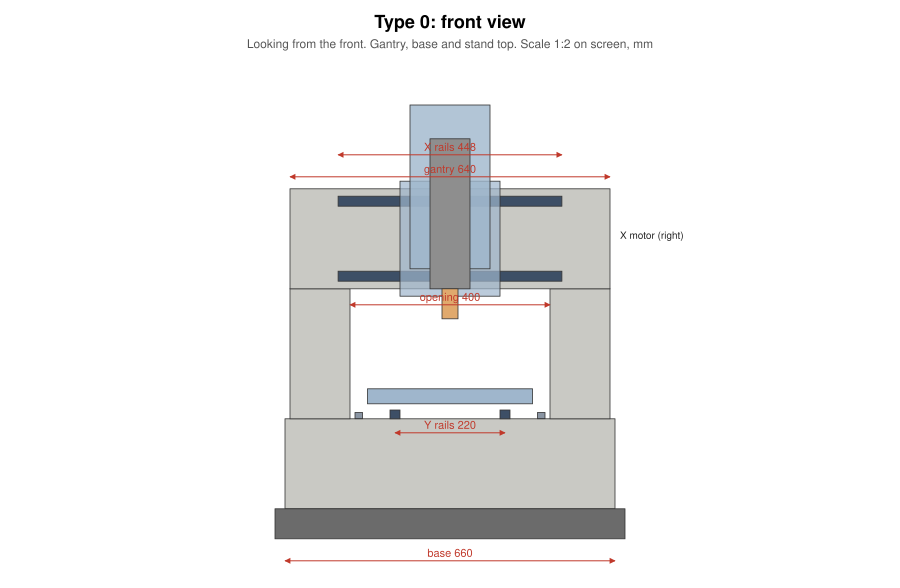

# Layout (draft 1)

Generated from [`cad/type0_layout.py`](../cad/type0_layout.py) (3D STEP: `cad/out/type0.step`) and [`cad/type0_drawings.py`](../cad/type0_drawings.py). Full numbers: [cad/out/dimensions.md](../cad/out/dimensions.md).

## What the layout changed

| Item | Before | Now | Why |
|---|---|---|---|
| Y travel | 250 + about 100 | **250 + 145 = 395** | To reach the back rack row, the front row sticks 95 mm in front of the spindle. The table must clear it |
| Base | 900 × 660 × 180 | **970 × 660 × 180, about 265 kg** | Longer Y travel plus the rack park area |
| Gantry | 640 × 460, opening 400 × 260 | unchanged, about 70 kg | |
| Epoxy / aggregate | 41 / 300 kg | **37 / 298 kg** (at 11%), + about 4 kg for leveling and samples | |
| X rails | 450 | **448 minimum: buy 500** | 450 leaves only 2 mm |
| Z rails | 300 | **330 minimum: buy 350** | Block pitch + travel |
| Y ballscrew | 500 | **550** | Longer Y travel |
| X / Z ballscrews | 420 / 280 | 405 / 305 minimum: buy **420 / 310** | |
| Rack slide rails (MGN15) | 2 × 400 | **2 × 550** | Rack stroke 395 mm |
| Rack screw (SFU1204) | 400 | **500** | |
| Stand steel | 3 m (placeholder) | **11.9 m of 60 × 60 × 3, braced** | 950 mm table height, 700 × 1,010 footprint |
| Rack fork plane | — | 140 above base | Tools hang clear of the Y rails |
| Z assembly | — | Rises about 170 mm above the beam at Z top | Normal for 150 mm Z: the enclosure must be tall enough |

## Problems found
1. **Cabinet did not fit inside the stand** (500 mm tall vs about 400 clear). Fixed: 600 × 400 × 200 cabinet inside (D-53), and 440 mm clear with 60 mm tube.
2. **Stand steel.** Changed to 60 × 60 × 3 with diagonal bracing, about 11.9 m (D-54). Price to re-check.

## Assumptions to verify (marked VERIFY in the script)
- HGR20/HGH20CA: block height 30 mm, block length 77.5 mm.
- DFU1605 nut length 90 mm, BK12/BF12 45 mm total.
- **Y nut housing vs table (checked 2026-11-05):** DSG16H drawing: screw centre 20 mm below its mounting face, total height 40 mm. Bolted under the table (underside 30 mm above the base), the screw centre sits **10 mm above the base** and the housing bottom **10 mm below** it. **Plan: cast a channel about 70 mm wide × 25 mm deep along Y between the rails** (a raised strip on the mould floor), with pads for the BK12/BF12 supports set so their centre height matches. Check the BK12/BF12 centre height on the parts you receive before making the mould.
- Ballscrew kits bought at the next size up: X 450, Y 550, Z 350 (listing lengths). Confirm whether they are overall or thread length.
- Spindle length about 300 mm including the release cylinder.
- Stack from spindle axis to beam face: 160 mm.
