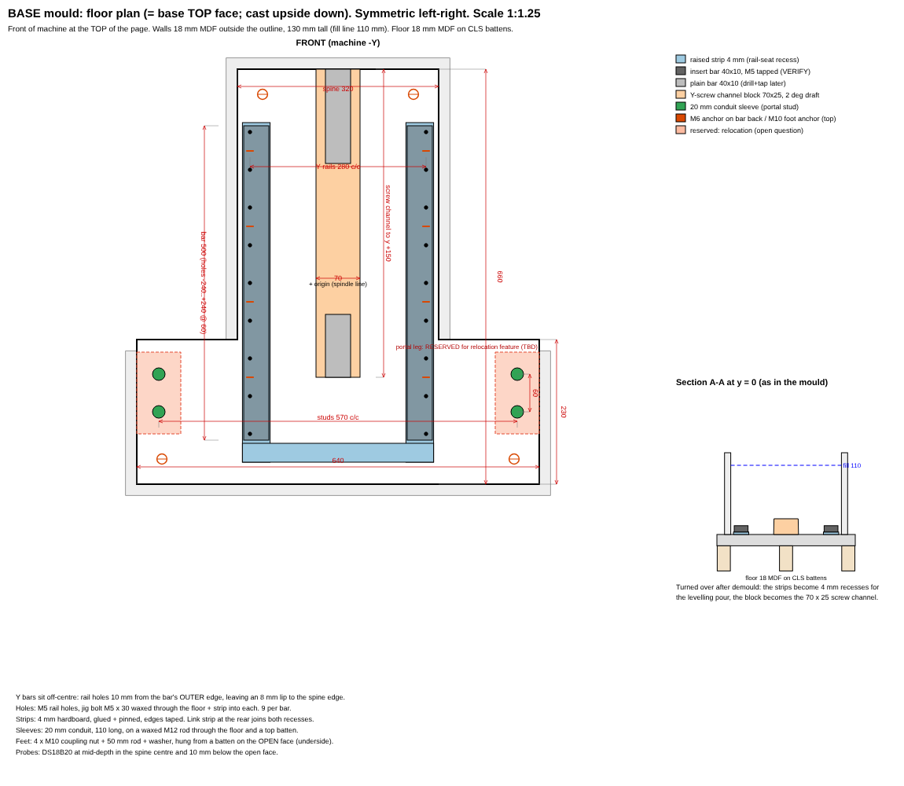
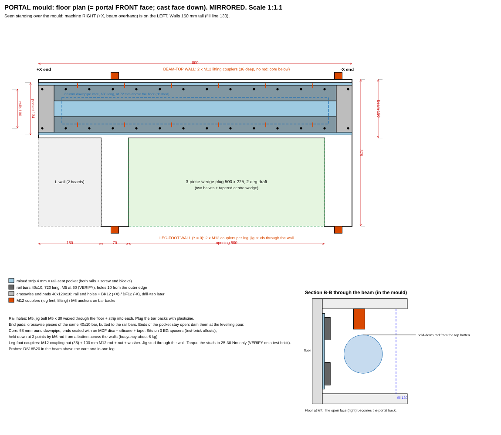

# Moulds for the v2 castings (task 4, D-96)

Drawings are generated from the v2 model: [`cad/v2/moulds.py`](../cad/v2/moulds.py) → `cad/v2/out/mould_base.svg`, `mould_portal.svg`, `mould_sheet.svg` and [`moulds_parts.md`](../cad/v2/out/moulds_parts.md) (MDF panels, insert bars, fixings). The general method (mould floor as the jig, release, pour and demould sequence, vibration table) is in [eg-moulds.md](eg-moulds.md); this file has the v2 specifics.

**Before marking out the floors (week 9):** the X and Y rails and the ballscrew kits arrive in wave 2 (D-93). Measure them, change the VERIFY values at the top of `moulds.py` (rail hole pitch and end distance, channel end, pad positions) and re-run.

## Base (72 kg)

- **Cast upside down**: the top face (rails, portal joint) lies on the floor. The base is symmetric left to right, so the floor is marked out exactly as the drawing.
- **Size:** T-shape, spine 320 × 660, rear cross-piece 640 × 230, 110 thick. Walls 130 tall (fill line 110).
- **Y rail seats:** two raised strips (4 mm hardboard, 44 wide) under the rails, joined by a cross-link strip at the rear. After demould they are 4 mm recesses for the levelling pour, linked so both rails settle at one level. Rails 280 apart (D-80).
- **Y insert bars (2 × 500):** 40 × 10, tapped M5 at the rail hole pattern (9 holes at 60 mm, VERIFY on the rails). **Off-centre:** the rail holes are 10 mm from the bar's outer edge, so the bars stay 8 mm inside the spine edge. A centred bar would reach the edge (rails 280 apart on a 320 spine).
- **Y-screw channel (D-56):** a block 70 wide × 25 high with 2° draft, from the open front end to y +150 (VERIFY with the screw kit). Two plain bars sit on it (become the channel floor): 150 long at the front for the motor mount and BK12, 100 long at the rear for the BF12. They are drilled and tapped after casting, to the real parts. The BK12 will need a spacer of about 10 mm to bring the screw up to the nut (VERIFY).
- **Portal joint:** 4 sleeves (20 mm conduit, F09) right through the cross-piece at the leg bolt positions (570 apart left-right, 60 apart front-back). The portal's studs drop through them and are nutted underneath (see the portal). Each sleeve sits on a waxed M12 rod through the floor and a batten above.
- **Feet:** 4 × M10 coupling nuts with a short rod and washer, hung from a batten on the open face (the underside), for the T02 levelling feet. They double as eye-bolt points for turning the casting over.
- **Reserved:** the area under each portal leg (pink on the drawing) is kept clear for the relocation feature. See "Open: portal relocation" below.

## Portal (39.6 kg)

- **Cast lying on its front face** (the X-rail face) on the floor. **The floor drawing is mirrored**: standing over the mould, the machine's right side (beam overhang) is on your left.
- **Size:** 800 × 375 × 130. Beam 150 tall (D-94), legs 70 wide, opening 500 × 225, beam overhang 160 to the right. Walls 150 tall (fill line 130).
- **X rail-seat pocket:** one raised strip 134 wide (z 233–367) along the whole beam: both rails and the screw end blocks sit in one recess, so one levelling pour sets them all at one level. The pocket ends stay open; dam them with tape or plasticine at the levelling pour. The lips above and below are 8 mm.
- **X rails 100 apart (D-94)**, at z 250 and 350. That leaves a 56 mm gap between the carriages (HGH20CA 44 wide) for the X nut housing. VERIFY the housing width on the M05 kit.
- **X insert bars:** 2 × 720 (x −280 to +440), tapped M5 at 60 (12 holes each), holes 10 mm from the outer edge of each bar. **Crosswise end pads** (40 × 120) at both ends take the rail end holes (pre-tapped) and the BK12 (+X end, motor side) or BF12 (−X end), drilled later.
- **Core (D-95):** one 68 mm round downpipe, 680 long, in the beam at 72 mm above the floor. Ends sealed (MDF disc + silicone + tape). It sits on 3 small EG spacers (offcuts of the test bricks) and is held down at 3 points by M6 rod from a batten across the walls (it floats with about 6 kg).
- **Leg feet:** 2 × M12 coupling nuts per leg in the leg-foot wall (z = 0), each with 100 mm of M12 rod, a nut and a washer as the anchor. Jig studs through the wall hold them. Later, M12 studs screw in, drop through the base sleeves and are nutted under the base. **Torque them to 25–30 Nm only** until a test brick proves more (eg-mix.md). This replaces the full-height bolt sleeves in v2-design.md: those would have crossed the core.
- **Lifting:** 2 × M12 coupling nuts in the beam top (over the legs), 36 deep with no rod (the core is below). M12 eye bolts for lifting the portal onto the base.
- **Opening:** 3-piece wedge plug (two halves and a tapered centre wedge, 2° draft). The overhang notch on the right is just two boards (an L), open on two sides.

## Materials
All mould panels come out of **one 18 mm MDF sheet** (F10): see the layout in `mould_sheet.svg`. Insert bars use **2,962 mm of the 3 m bar** (F07): little to spare, so cut carefully. Fixings and anchors are listed in `moulds_parts.md`. New BOM lines: F19 hardboard, F20 downpipe, F21 coupling nuts, F22 M5 × 30 jig bolts (all TO PRICE, wave 2).

**Bar anchors:** on the back of each bar, blind M6 holes 6 mm deep, midway between rail holes every 120 mm, with an M6 × 20 screw and nut as a hook (28 in total, X03 has 50). Sand and degrease the bars before casting. Rail bolts: M5 × 20 (not × 16) so they still reach the bar through the levelling layer (VERIFY with the rail's counterbore depth).

**Vibration table deck** (F14, owner DIY): at least 950 × 820 so both moulds fit, with stop blocks screwed on.

## Order of work (weeks 9–14)
1. Rails and screws in hand (wave 2): measure, update `moulds.py`, re-run, print the drawings 1:1 in tiles or mark out from the dimensions.
2. Cut the MDF (panels list), seal cut edges, mark out the floors from one datum corner, drill the jig holes with a drill guide (±0.2 mm across the 280 mm and 100 mm rail spacings: the rails can still be aligned within their M5 bolt clearance).
3. Strips glued and pinned, edges taped. Insert bars tapped, anchors fitted, bolted to the floors with waxed M5 × 30 jig bolts. Plasticine over the bar backs at each hole.
4. Walls, plug, sleeves and couplers on their jig rods. Release: **conflict to settle.** eg-moulds.md says 3 coats of wax, then PVA; the BOM note on F12 says Easy Composites advise **not** to put PVA over wax. The test-brick moulds try wax only and PVA only (eg-mix.md); use whichever released cleanly.
5. Sand-fill test on the vibration table: no bulging, no leaks.

## Open: portal relocation (owner asked for an independent assessment, 2026-11-15)
The machine has to come apart to move upstairs, so the portal must go back onto the base in the same place. v2-design.md planned 1 reamed Ø10 dowel per leg. The moulds keep the area under each leg free until this is decided. Options found so far, for assessment (not a recommendation):

| Option | How | For | Against |
|---|---|---|---|
| A. Grout keys | 2 cone-shaped pockets cast into the base under each leg (cones on the mould floor). At the first assembly the base side is waxed, so the grout bonds to the leg and forms cones that drop back into the pockets | No drilling. Nothing to buy. Locates in X and Y | Repeatability depends on the release film and clean pockets. Not proven on a DIY EG machine (no example found yet) |
| B. Dowels in cast sleeves | A Ø20 sleeve in each leg and a steel bush in the base; a Ø10 dowel set in epoxy after the portal is squared | Classic, positive location | Needs parts set in the right place and an epoxy-set dowel; drilling through EG is not practical |
| C. Bolts and grout only | No location feature; re-square with the dial indicator after each move | Simplest | Re-alignment work after every move (the grout layer still sets the height) |
| D. Studs as locators | The 4 M12 studs in close-fitting bushes instead of 20 mm conduit | Uses parts already there | M12 thread is not a precise locating diameter; bushes would need reaming |

Whatever is chosen has to be in the base mould before the base is cast (week 15), so decide by week 9.
