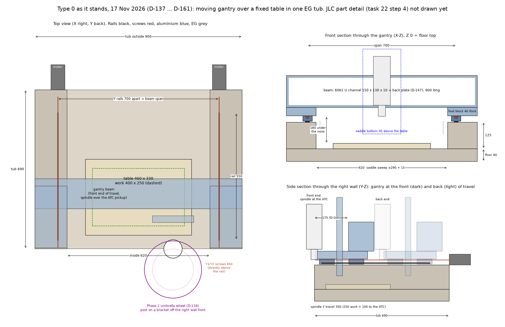

# Moving-gantry sketch (task 22, step 1; D-137, D-138)

**A proposal for the owner to agree or change. Nothing here is decided.** No STEP, no `bom.csv` change yet.

Script: `PYTHONUTF8=1 python cad/v2/gantry_sketch.py` (numbers in `cad/v2/out/gantry_sketch.json`). Z 0 = top of the tub floor; Y 0 = centre of the work area. The Z stack (saddle, Z plate, spindle 175 in front of the beam face, D-106) is kept as it is now.

## The layout

| | Proposal | Why |
|---|---|---|
| Work area | 400 × 250, Z 150, 180 under the nose (D-09) | unchanged |
| Table | 460 × 330 × 25, bolted straight onto the tub floor, fly-cut on the machine | a fixed table can be surfaced in place, so the floor needs no precision |
| Tub inside width | **610** | the 180-wide saddle sweeps ±290 in X, and the walls rise above its bottom edge; 15 mm clear each side |
| Walls | **140 wide**, tops **100 above the table** (Z 125) | rail 40 in from the inner edge, Y screw 65 outboard of the rail on the same top |
| Floor | 60 thick, full width | carries the table only |
| Tub outside | **890 × 630 × 185** high (630 with the ATC reach, 596 without) | |
| Y rails | on the wall tops, **690 apart** (= beam span) | |
| Y screws | on the wall tops, **outboard of each rail**; BK12 at the back, BF12 at the front, on the same levelled seat as the rail | the nut housing hangs from a 15 mm step machined in the aluminium foot block, so no cast step |
| Y motors | 2, direct-coupled behind the back end of each wall; the motors end about 185 behind the tub (815 overall) | front stays clear for the operator and the ATC |
| Gantry | aluminium box beam **150 × 130 × 10 wall, 890 long**, bolted on two **foot blocks 268 × 140 × 40** (pocketed), each on 2 HGH20CA blocks at 150 pitch | the walls are tall enough that the beam sits on the feet: no legs |
| Y carriages | centred **140 mm behind the spindle axis** (under the moving mass) | |
| X | rails 2 × **600** on the beam face (100 apart, D-104), screw **700**, belt-folded motor as now (D-107) | X travel is the work width only |

## Masses

| Tub variant (solid EG at 2,300 kg/m³) | kg | Epoxy at 11–12 % |
|---|---|---|
| **A** baseline above (ATC reach) | **128.1** | 14.1–15.4 kg |
| B as A + back wall 100 thick | 145.6 | 16.0–17.5 kg |
| C as A, floor 80 | 153.9 | 16.9–18.5 kg |
| D as A, walls only 50 above the table (the gantry gets 50 mm legs) | 107.8 | 11.9–12.9 kg |
| E as A + one Ø60 PVC core along each wall (40 mm cover each side, 20 under the rail bar) | 119.9 | 13.2–14.4 kg |
| F as A without the ATC reach | 121.2 | 13.3–14.5 kg |

- One pour instead of two (no rehearsal pour). The 22.68 kg Ampreg kit (D-122) covers 14–16 kg for the tub, leaving about 7–8 kg for the rail seats, grout and test bricks.
- The floor (60) is too thin for cores with 20 mm walls, so only wall cores are offered.
- **Moving mass in Y: about 50 kg** (beam 12.5, feet 5.7, Z stack and X parts; spindle ASSUMED 7 kg). Now the table moves about 15 kg. Two 4 Nm motors on 5 mm lead have plenty of thrust; acceleration is set by rotor and screw inertia, as now.

## Beam stiffness (150 × 130 × 10 box, 6082, E 69 GPa)

| 200 N at mid-span, span 690 (rail to rail) | EI | Simply supported | Ends fixed |
|---|---|---|---|
| Force in Y (cut along Y, bends the beam sideways) | **0.90 MNm²** | 1.5 µm | 0.4 µm |
| Force in Z (plunge) | 1.13 MNm² | 1.2 µm | 0.3 µm |
| Twist: Y force at the tool, 245 below the beam centre | GJ 0.56 MNm² | 3.7 µm at the tool | |

The beam is not the weak point. The Z stack overhang, the carriages and the bolted feet will bend more. Aluminium damps less than EG (D-137).

## Z clearance

- 180 under the nose at the top (unchanged). Beam bottom 170 above the table.
- **Saddle bottom 45 above the table** (unchanged from now): a part taller than 45 that reaches 115–145 mm behind the cutter hits the saddle. A shorter saddle would fix it later; not part of this sketch.
- Walls 100 above the table: parts and vices load from the front (open front, no front wall).

## ATC wheel (Phase 2, D-138)

- 8 forks at 70 pitch: Ø178 pitch circle, about Ø250 over the forks.
- Proposal: front right, **pickup at X +150, Y −225** (60 in front of the table edge), wheel centre Y −314, on a post on a bracket bolted to the right wall's front end (nothing cast).
- **This needs 100 mm more Y travel** (250 → 350): Y rails and screws **500 → 600**, tub +34 mm (+7 kg). D-138 said no Phase 1 part changes; this one does, and the LiMo order must know now.
- Without the extra travel, the wheel has to slide in under the spindle in Phase 2 (its own slide and actuator).

## Rail-seat levelling (D-12, D-42)

- The two wall tops are 690 apart. **With a back wall**, one linked pour runs round the U (left wall top, back wall top, right wall top) and both rails come out at one level.
- **Without a back wall**, link them with a temporary sealed MDF trough across the back ends of the walls, part of the mould kit, removed after cure. No cast feature.

## What the LiMo order (D-136) would become (for step 3, not changed yet)

| | Now (D-136) | Sketch, with ATC reach | Sketch, without |
|---|---|---|---|
| Y rails | 2 × 500 | 2 × **600** | 2 × 500 |
| Y screws | 1 × 600 | **2** × 600 | **2** × 500 |
| X rails | 2 × 800 | 2 × **600** | 2 × 600 |
| X screw | 850 | **700** | 700 |
| Z | 350 / 350 | unchanged | unchanged |

All under LiMo's 950 mm DDP sea limit. Also new: a 4th motor + driver (M09), 2 Y couplings and 2 Y motor mounts; portal casting lines out; gantry parts in. Electrical: Mesa channel 3 becomes Y2 (D-137).

## Not checked

- JLC's largest CNC part (the beam is 890 long): step 4.
- Spindle mass (7 kg ASSUMED), bought-part masses are catalogue-typical.

## Open choices (asked 17 Nov 2026)

Y screw placement; back wall; cores; beam section; ATC reach (extra Y travel); wall height. Answers (owner, 17 Nov 2026): outboard on the wall tops (D-140); no back wall, solid, walls 100 above the table (D-139); ATC reach added, Y travel 350 (D-141); Y motors direct at the back (D-142). **Beam: the next task assesses how it is made (D-143).**
