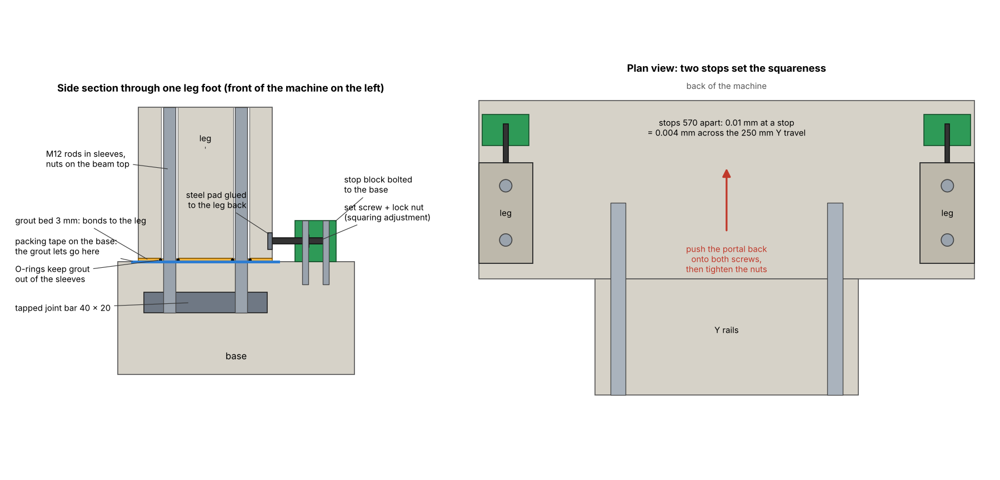

# Putting the portal back in the same place (assessment, 15 Nov 2026)

**Status: recommendation for the owner to decide.** Nothing here is in the CAD yet. The question came from the Opus session's handover (branch `claude/awesome-ramanujan-by9kds`); this assessment is done on the current design (this branch).

## The problem in plain words

The machine is built in the shed, then taken apart and carried upstairs. The portal (37.6 kg) is the only joint in the frame. When it goes back on the base, three things must come back as they were:

1. **Height and lean** of the portal. If a leg sits a little higher or tilts, the spindle is no longer square to the table.
2. **Twist** (seen from above): the X rails must be square to the Y rails. This is the one that shows up in parts: a twist of 0.05 mm across the portal makes every rectangle slightly a parallelogram.
3. **Position** forwards-backwards and left-right. This does not affect accuracy at all. It only moves the zero point, and the machine is homed again anyway.

So the job is smaller than it looks: **make the seat repeat (1), and make the twist repeat (2).**

## What is wrong with the current plan

The plan says "grout, then a Ø10 dowel per leg, reamed after grouting". Two problems:

- **The grout would glue the portal to the base.** Nothing in the plan makes it let go. Taking the machine apart would break the grout or the casting.
- **The dowel can't be reamed.** Once the portal is bolted down, the dowel hole is under a 375 mm tall leg. There is no way to get a reamer to it.

## Options

| Option | How it works | Repeats to about | For | Against |
|---|---|---|---|---|
| **1. Released grout bed + two adjustable stops (recommended)** | The grout bonds to the leg feet only; packing tape on the base makes it let go. Two steel blocks bolted to the base behind the legs each carry a set screw that touches a steel pad on the leg back. To refit: lower the portal, push it back onto both screws, tighten | 0.01 mm at each stop (my estimate, to measure) | Done after the machine is built and proven. Adjustable for ever. Everything is visible and can be checked with a feeler gauge. Costs almost nothing. Cannot lock the portal on | You must push the portal against the stops while tightening. A screw knocked out of adjustment loses the setting (lock nut + paint mark) |
| 2. Dowels in bushes set in epoxy | A hardened pin in a bush cast into each leg foot; a second bush floats in an oversize pocket in the base and is set in epoxy at the first assembly | 0.01–0.02 mm (pin clearance in a drill bush) | Self-locating: lower the portal and it is in place. Standard jig-making practice | Blind: it all happens under the leg, on grouting day, with the squaring. Epoxy on a pin would lock the portal on for good. Not adjustable afterwards |
| 3. Grout keys | Cones cast into the base; the grout forms matching cones on the leg | Unknown | Nothing to buy | No example found. Epoxy cone edges chip. Same blind risk as option 2 |
| 4. Bolts and grout bed only | No locating feature. Re-square with a dial indicator and a square after each move | As good as the measuring | Simplest | Needs a precision square (not owned) and an hour or two each move |
| 5. The M12 rods as locators | Close-fitting bushes round the rods | 0.1 mm or worse | Uses parts already there | A thread is not a locating surface |

## Why option 1

- **It separates the jobs.** Grouting day is only about the seat. The squareness is set later, with the machine running, by turning two screws and cutting a test square. Options 2 and 3 fix the squareness for ever on grouting day, blind.
- **It can be corrected.** If a test cut shows the axes 0.03 mm out of square, that is 0.07 mm at one stop, or about 20° of turn on an M8 screw (pitch 1.25 mm). A fine-pitch M8 × 1.0 screw would make it a little easier.
- **The numbers are comfortable.** The stops are 570 mm apart and Y travel is 250 mm. An error of 0.01 mm at one stop is 0.004 mm across the whole Y travel, well inside the ±0.02 mm target.
- **It needs almost nothing in the moulds:** 4 × M8 inserts in the base top (2 behind each leg) and no dowel sleeves.

## What it needs

**In the base mould:** 2 × M8 nut-on-rod inserts behind each leg, at X ±285, Y 272 and 292, set on jig bolts through the mould floor like the other inserts. The base has 80 mm of free top face behind each leg (the legs end at Y 240, the cross-piece at Y 320). **Remove** the Ø12 dowel sleeves from both castings.

**Parts (all from stock already on the list):**
- 2 stop blocks 40 × 20 × 60 from the F20 offcut (260 mm spare), each drilled for 2 × M8 and tapped M8 for the set screw.
- 2 set screws M8 × 50 with lock nuts, 2 steel pads about 15 × 15 × 4 glued to the leg backs with epoxy.
- 4 O-rings or printed TPU rings round the M12 rods, so grout cannot run into the sleeves or the tapped bars.
- Packing tape (F18) on the base under each leg.

**First assembly:**
1. Tape the base where the legs stand. Rings over the rods.
2. Stand the portal on 3 small shims, square it roughly, pour or trowel the grout (Ampreg thickened with whiting), snug the nuts. Cure and post-cure.
3. Torque the nuts. Fit the stop blocks. Glue the pads to the leg backs.
4. With the machine running: measure the squareness of X to Y, slacken the nuts, adjust the two screws, tighten, measure again. Lock the nuts and mark them with paint.

**After a move:** clean both faces, lower the portal over the rods, push it back onto both screws (a strap round the legs and the cross-piece, or a few taps with a soft mallet), check both screws touch with the 0.04 mm feeler, torque the nuts in the same order to the same value.

## Evidence

- **Dowels reamed after alignment** are the standard machine-tool way to make parts go back together; hardened ground pins vary under 0.001 in, soft ones much more ([Eng-Tips, dowels for locating machine parts](https://eng-tips.com/threads/dowels-for-locating-machine-parts.89545); [taper dowel repair note](https://industrialmonitordirect.com/blogs/knowledgebase/taper-dowel-repair-for-worn-machine-tool-holes)). This is why option 2 is credible, and why the original plan named dowels. *Read from search summaries, pages not opened.*
- **Bushes set in epoxy on a locating pin** are an old jig-making method ([US patent 3212181, locating drill jig parts](https://patents.google.com/patent/US3212181A/en); [Carr Lane liner bushings](https://carrlane.com/product/drill-bushings/liner-bushings)). One patent warns that cure heat can move the bush. *Search summaries.*
- **A hard ball or screw tip against a hard flat repeats to about a micron or better** when pressed with the same force: published tests on ball-and-groove couplings give about 0.25 µm ([Culpepper, quasi-kinematic couplings, via a University of Arizona synopsis](https://wp.optics.arizona.edu/optomech/wp-content/uploads/sites/53/2016/10/521synopsis_Masaki-Hosoda.pdf)). Our stops are cruder (hand push, EG behind the pad), so I use 0.01 mm. *Search summary; the 0.01 mm figure is my estimate.*
- **Hobby EG builds:** one builder put an O-ring round each stud to stop epoxy rising into the gantry bolt holes, and noted the gantry had to be aligned in all 3 axes before the epoxy set ([MyCNCUK, thread 14662](https://www.mycncuk.com/threads/14662-Advice-on-ballscrew-mounts-for-epoxy-granite-rebuild)). **I found no hobby EG build that takes the gantry off and puts it back**, and no report of a released grout joint. That part is unproven and must be tested. *Search summary.*
- **Release is the real risk in every option:** machine rebuilders using replicated epoxy warn that too little release agent glues the parts together ([CAD_CAM_EDM_DRO archive](https://buildbotics.com/archive/cad_cam_edm_dro/messages/7680.html)). *Search summary.* Epoxy does not bond to polypropylene packing tape, which is why the tape is the release here and not wax alone.

## Tests before trusting it

1. **Released grout on a test piece** (weeks 12–13, added to `eg-mix-test-plan.md` as piece F): tape one sawn brick half, grout a second half onto it with thickened Ampreg, cure, post-cure. Pass: they part by hand, the grout stays on the untaped half, and they go back together with no rock and no gap for a 0.04 mm feeler.
2. **Shed trial before the move:** with the machine finished, measure squareness, take the portal off, put it back, measure again. Do it twice. Pass: squareness changes by less than 0.02 mm over 250 mm.

## Cost

Nothing to buy: the blocks, pads, screws, tape and rings come from parts already on the list or are printed. The 2 dowels and sleeves in the old plan are no longer needed.

## If you prefer dowels (option 2)

It can be done, with a drill bush cast into each leg foot, a Ø25 × 22 pocket under it in the base, and a plastic washer over each pocket so the grout and the potting epoxy stay separate. It needs 4 drill bushes and 2 hardened pins to price, and a trial on test pieces first. I would only choose it if pushing the portal against stops at each move seems worse to you than the blind work on grouting day.
