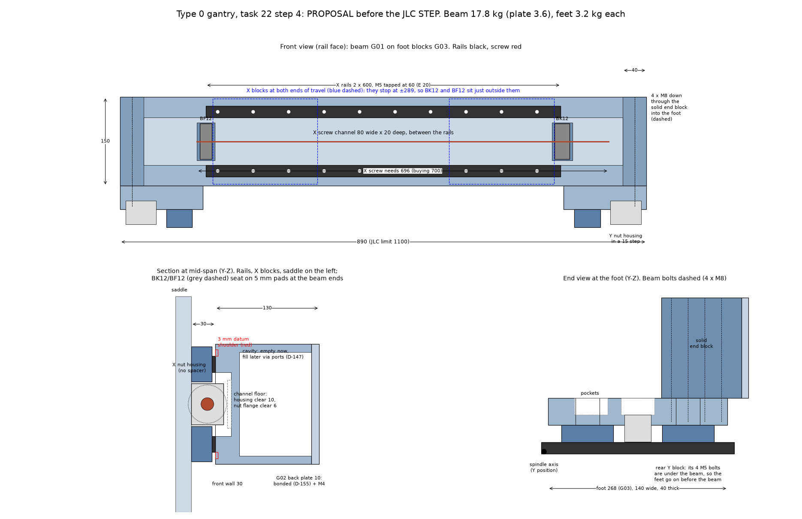

# Task 22 step 4: gantry parts before the JLC STEP (17 Nov 2026)

**A proposal for the owner. Nothing here is decided, and no STEP has been made yet.** The STEP for the JLC quote comes after the answers below.

Script: `PYTHONUTF8=1 python cad/v2/gantry_parts_sketch.py` (numbers in `cad/v2/out/gantry_parts_sketch.json`). Bought-part sizes come from `cad/vendor/README.md` (HIWIN, Engder vendor STEPs) and `assembly.py`. JLC's limit (1100 × 600 × 500, curl, 17 Nov) is already checked.

## Two problems found

1. **The X screw has no room.** In the cast portal, the X screw ran in a 45 mm channel behind the beam face (D-108). A 10 mm aluminium wall can't hold that. With the rails straight on a 10 mm face, the X nut housing (40 tall) has only the 30 mm block height to sit in, so it hits the beam.
2. **The rear Y block is under the beam.** HGH20CA blocks bolt only from the top. The rear block of each foot sits under the beam, so its 4 bolts can't be reached once the beam is on.

## The proposal

| Part | Proposal | Why |
|---|---|---|
| G01 front wall | **30 thick** (was 10). An **X screw channel 80 wide × 20 deep** between the rails, with a 10 mm floor | The outside stays 150 × 130, so the spindle stays 175 in front of the face (D-106) |
| X nut housing | Bolted straight to the saddle. **The D-108 spacer goes.** Screw axis 10 in front of the rail seat | 10 mm clear of the channel floor; the nut flange clears it by 6 |
| BK12 / BF12 | On 5 mm pads on the channel floor, **just outside the X blocks' travel** (blocks stop at ±289; BK 290–327, BF −310 to −290) | Below the blocks there is no room (BK12 is 60 wide up to 33.5 high) |
| X screw | Needs **696**; 700 is bought (D-150) | 4 mm spare. The X stub drawing (task 13) must use these positions |
| X rail seats | Rails on the front face, M5 tapped 14 deep at 60 pitch (E 20); M5 × 20 gives 11 mm thread in aluminium. **3 mm datum shoulder** on the outer edge of each rail | Under the block's 4.3 mm clearance (HGH20CA H1). Machined in one set-up, so both rails come out parallel |
| G01 ends | **Solid end blocks 40 long**, each with **4 × M8 holes straight down** into the foot (counterbored at the top) | The bolts are reached from above and don't pass through the cavity, so a later fill can't leak |
| Assembly order | Feet onto the Y blocks first (all 8 M5 bolts open from above), then lower the beam on and bolt it down | Solves problem 2 |
| G02 back plate | 150 × 890 × 10, bonded (D-155) plus M4 at about 75 pitch into the top, bottom and end walls. **3 fill ports Ø25** with 4 × M4 each for a cover disc | D-147: nothing may block a later fill |
| G03 foot blocks | 268 × 140 × 40. 2 × HGH20CA (4 × M5 counterbored each, 32 × 36). A **15 step** underneath for the Y nut housing (D-140). 4 × M8 tapped for the beam. 2 pockets 60 × 100 × 25 from the top, in front of the beam | |
| Threads and tolerances | STEP has no threads. Plain holes at tap-drill size, plus a one-page drawing listing the threads and the critical faces (rail face flatness and the shoulder) | JLC states only ±0.05 general |

## Masses

- Beam G01 **14.2 kg** + back plate G02 **3.6 kg** = **17.8 kg** (the sketch had 12.5). The 30 mm front wall and the solid ends add it.
- Foot blocks **3.2 kg each** (the sketch had 2.8).
- **Moving mass in Y: about 56 kg** (was about 50).

## Questions for the owner

1. **X screw:** a 30 mm front wall with the 80 × 20 channel, the D-108 spacer dropped? The other way is raised rail lands 20 high, which moves the spindle 20 further out (longer overhang). My pick: **the channel**.
2. **BK12 / BF12 outside the X block travel**, X screw needs 696 of the 700 bought? My pick: **yes**.
3. **Beam to foot:** solid 40 mm end blocks with 4 × M8 down into each foot, feet fitted first? The other way is moving the carriages forward so both Y blocks are in front of the beam (they'd then sit 58 mm off the moving mass's centre). My pick: **end blocks**.
4. **Datum shoulder** 3 mm on both X rails? My pick: **yes**.
5. **Back plate:** M4 at about 75 pitch plus the bond, and 3 Ø25 fill ports with cover discs? My pick: **yes**.
6. **Foot pockets:** 2 pockets from the top in front of the beam, or leave the feet solid (+0.6 kg each)? My pick: **pockets**.
7. **Holes JLC makes** are only those needing accuracy (rail, BK/BF, Y block, beam-foot, back plate, ports). You drill the rest later (X drive bracket, cable chain, home switches). Agree?

## After the answers

1. `cad/v2/gantry_parts.py`: G01, G02, G03 as STEP (one solid each, 6061), checked by re-import (solid, size, mass), plus the thread drawing.
2. **The owner uploads them to JLCCNC** (browser; not curl): 6061, G01 × 1, G02 × 1, G03 × 2, standard finish. G01–G04 in `bom.csv` stay unpriced until then.

## Basic STEP for the price (17 Nov 2026, owner: "very basic cad model for the JLC to price now")

`PYTHONUTF8=1 python cad/v2/gantry_parts.py` → `cad/v2/out/jlc/` (re-import check in `gantry_parts.json`). Uses my picks above; **the 7 questions are still open**, so the final model may differ.

| File | Qty | Size (mm) | Mass | Features |
|---|---|---|---|---|
| `G01_beam.step` | 1 | 890 × 120 × 150 | 13.6 kg | U channel open at the back, 30 front wall, 80 × 20 screw channel, 40 solid ends, 20 × M5 rail holes (Ø4.2 × 14), 8 × Ø9 beam-to-foot, 24 × M4 (Ø3.3) for the plate |
| `G02_back_plate.step` | 1 | 890 × 10 × 150 | 3.55 kg | 3 × Ø25 fill ports, 24 × Ø4.5 |
| `G03_foot_block.step` | 2 | 140 × 268 × 40 | 3.48 kg | 2 pockets 40 × 100 × 25, 8 × Ø5.5 (Y blocks), 4 × M8 (Ø6.8 × 20) |

Not in it yet: rail datum shoulder, BK/BF pads and holes, the 15 mm Y nut step under the feet, port cover holes, counterbores. **Owner:** upload the 3 files to JLCCNC, 6061, standard finish (G03 qty 2), and send me the price.
