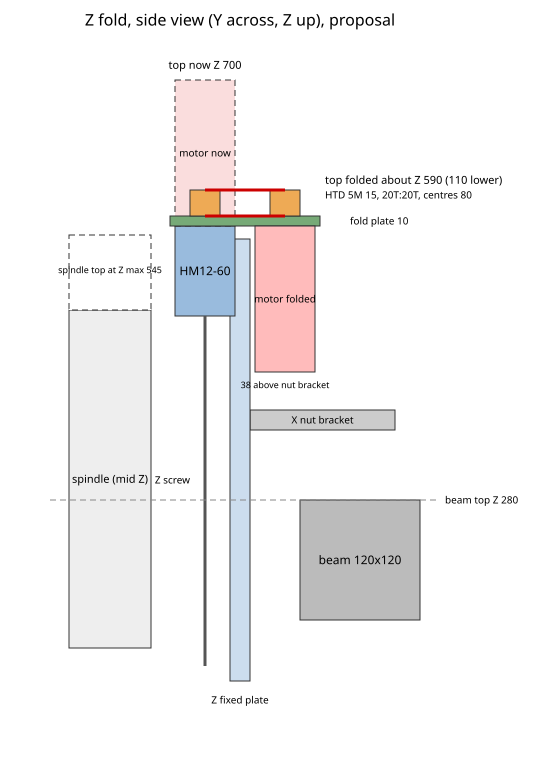
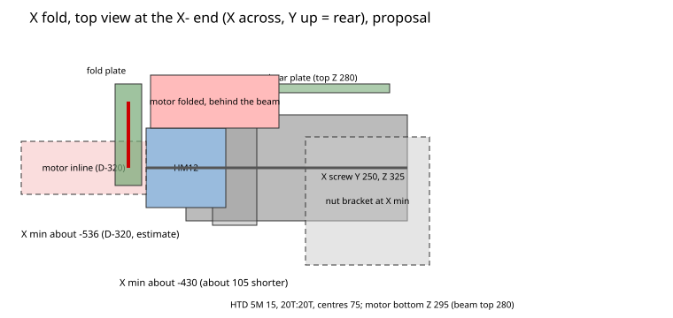
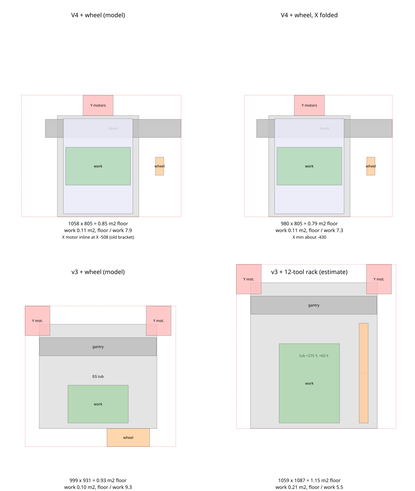

# Task 28: belt folds (Z and X) and the footprint comparison (25 Nov 2026)

**Rough sketches, not modelled. Nothing here is decided: the owner chooses.** Sizes are read from the `Type_0_v4` and `Type_0_v3` bounding boxes (25 Nov). Drawings: `python tools/task28_sketches.py` writes `docs/sketches/task28_*.svg`.

## 1. Z motor fold (D-322: belt with margin, brake stays on the motor)

Now: 24HS34 brake motor on top of the HM12-60, direct, top of the machine **Z 700**. HM12 Z 464 to 554, screw axis X 0, Y 95.

Proposal:
- **Motor behind the Z fixed plate**, shaft up, centred on X 0, Y 145 to 205 (centres 80 from the screw), body Z 408 to 554. It moves with the Z plate along X and stays out of the ATC side.
- Clearances read from the model: 38 above the X nut bracket (top Z 370); the beam (top Z 280) and the X screw stack (top Z 355) are lower still; nothing on the beam top is above Z 408. Y 145 to 205 is behind the plate (Y 140) and in front of nothing taller than Z 370.
- A 10 mm fold plate on the HM12 top (Z 554 to 564), two HTD 5M 20T 15-wide pulleys and a **HTD 310-5M-15** belt (2 x 80 + π x 31.8 = 310, 62 teeth). The vendor pulley STEP is already in `cad/vendor/htd5m_20t_15.step`. Slots in the plate set the tension.
- **Top about Z 590, about 110 lower** (not 150 to 180 as first guessed). That is close to the floor anyway: the spindle top reaches Z 545 at the top of Z travel, plus its cable plug.

**Catch: the HM12-60-V holds the coupling inside it** (screw end 10 x 21.5 in the coupling at Z 510 to 546). A pulley needs a shaft above the HM12. Two ways:
- (a) Keep the HM12 and the screw as ordered: a short Ø10 stub shaft in the coupling's top half, carried by 2 bearings in a thicker fold plate, pulley on the stub. No screw change.
- (b) Longer screw drive end (pulley straight on the screw), HM12 top bored through or a plain fixed block. This reopens D-207/D-211 and the LiMo Z screw line before wave 1.

**Belt margin (D-322) not checked yet.** Load case: the motor's stall torque (or the brake's holding torque) on the 31.8 pitch diameter. Belt rating to be read from a maker's page, not guessed. Pulleys, belt and bearings are **not priced**.

## 2. X motor fold

Baseline is **D-320 (not modelled yet)**: a second HM12-60 on the X- pad, motor in line past the beam end. The model still shows the old bracket with the motor at X -508 to -362; with the HM12 the inline motor ends further out, about X -536 (estimate: HM12 about 90 long, motor 146).

Proposal (the same idea as the old D-107 fold of the v2 design):
- Pulleys just outboard of the HM12, motor **behind the beam**, shaft -X, body along +X at Y 295 to 355, Z 295 to 355 (screw axis Y 250, Z 325; centres 75; belt **HTD 250-5M-15**, 50 teeth).
- Clearances: the X nut bracket reaches Y 285 (motor 10 behind it); the motor bottom Z 295 is 15 above the beam top and the rear shear plate tops (Z 280). The motor lies over the left upright and shear plate, which are all below Z 280.
- **X min about -430 instead of about -536: about 105 shorter.**
- With the Z fold as well: at the X- limit the Z motor (Y 145 to 205) and the X motor (Y 295 to 355) do not meet.
- Same HM12 coupling catch as Z (the X screw is ordered with the Z-style 10 x 21.5 end, M05).

**Conflict with D-320:** the owner dropped the X motor bracket yesterday ("just use an integrated mount"). A fold needs a plate on the HM12 again, carrying the motor and the belt tension. Ask before going on.

## 3. Footprint: V4 against moving gantry with a straight rack (Max)

Same scale, top view. Red dashes: overall envelope including motors; green: work area. 12 tools; the rack at **60 pitch (D-17)**, so 660 of rack.

| Layout | Envelope X x Y | Floor | Work | Floor per work |
|---|---|---|---|---|
| V4 + wheel (model; X motor at -508) | 1,058 x 805 | 0.85 m² | 430 x 250 = 0.11 m² | 7.9 |
| V4 + wheel, X folded | about 980 x 805 | 0.79 m² | 0.11 m² | 7.3 |
| v3 + front wheel (model) | 999 x 931 | 0.93 m² | 400 x 250 = 0.10 m² | 9.3 |
| v3 + 12-tool rack (estimate) | about 1,059 x 1,087 | 1.15 m² | 400 x 525 = 0.21 m² | 5.5 |

How the v3 + rack row was made: v3's Y reach is 385, so 660 of rack along Y needs about +275 Y (tub, rails and screws 275 longer), and the rack on the +X wall top needs about +60 X of reach (beam and tub). The longer Y then gives about 525 of usable bed. The front wheel goes.

- **Max is right about floor per work area:** a moving gantry with a rack along the bed gives about twice the bed for about 35 % more floor (5.5 against 7.9).
- **But it is more floor, not less**, and it goes back to the cast tub and the long Y that V4 left (D-305 to D-307). V4 + rack along X stays at about +480 X (V4 design spec).
- If floor per work matters more than total floor, the question is a V5, not a change to V4.

## Answered (25 Nov): 1 fold, stub shaft (D-325); 2 fold X (D-326); 3 keep V4, frozen (D-324)

## Questions for the owner (answered)
1. Z fold: go on with it (top about 110 lower)? If yes, (a) stub shaft in the HM12 or (b) longer screw end?
2. X fold: worth a motor plate again (against D-320), for about 105 of X?
3. Footprint: keep V4 as it is, or look at a moving-gantry V5 with a straight rack?
